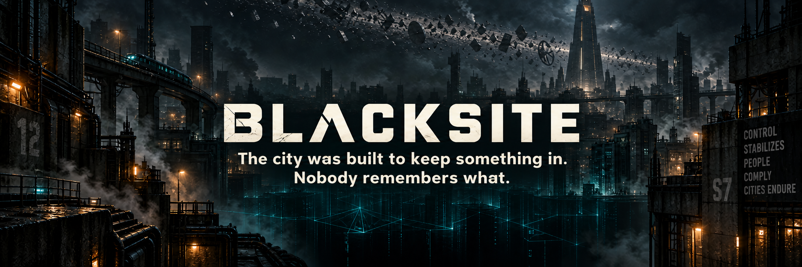

# Blacksite

*The city was built to keep something in. Nobody remembers what.*

Blacksite is a real-time multiplayer door game for
[NetBBS](https://github.com/Thiesi/NetBBS): a cyberpunk city called Karst,
sealed off from the world for forty-one years under a sky full of
orbital wreckage, with a network underneath it that has been very
patiently running the numbers. Players are Wakes, freshly decanted
clones with no memories, and the game is about what they become and how
far down they are willing to go.

It is played in a terminal, over Telnet, SSH, or NetBBS's web client,
at 80×24 or larger, in colour. Several callers on the same node share
one persistent world in real time: they see each other move, fight, and
talk; they run the city's network (the Lattice) while crewmates guard
their bodies; they capture relays for their factions; and once a season
they go down into the Blacksite together.

## Status

**M2 Lattice and interlock implemented (S01-S15).** The M0 foundation,
shared movement, sight, fog memory, ten maps and persistent characters are
available. The service now starts the Wake for new callers. See the
[character guide](docs/ops/characters.md) for persistence, sleeper recovery
and acceptance. The [zone preview guide](docs/ops/zones.md) covers temporary
bodies. The [city guide](docs/ops/city.md) covers connected hub routes,
scheduled trams, safety pockets and the visited-zone overview. Other
gameplay follows in later slices. The [social guide](docs/ops/chat.md)
covers chat, emotes, sitrep privacy, ignore/report and replayed logs. The
[item guide](docs/ops/items.md) covers equipment, counter trading,
five-minute caches and banking. The [combat guide](docs/ops/combat.md)
covers targeting, abilities, clone settlement and recovery. The
[NPC guide](docs/ops/npcs.md) covers city traffic, patrols and heat. S13 adds
[Lattice traversal](docs/ops/lattice.md): eleven district sectors, public
terminal loans, native/portable rigs and the body left behind. S14 adds
core encounters, 35 programs, readable ICE and seeded Silt descents.
S15 joins the layers with [live controls](docs/ops/interlock.md), hardware
power cuts and private-core integration for S18's future rentals. Future-zone
vendors remain staged for
S25; the playable city stays the ten-zone hub. The
[deployment guide](deploy/README.md) covers service units and operator
commands. See `docs/plan/00-roadmap.md` for the plan and the
[issues](../../issues) for what is being worked on. The foreground
[server smoke test](docs/ops/server-core.md) documents the current tools.
The [door client guide](docs/ops/door-client.md) covers registration and
transport acceptance.

Blacksite is developed as a third-party native door: it has no commit
access to NetBBS. What it needs from the platform is written up in
`docs/upstream/` and filed in the NetBBS repository.

## Read this first

- Players and the curious: `docs/world/00-bible.md`.
- Developers and agents: `AGENTS.md`, then `docs/design/02-architecture.md`.
- SysOps: the operator guide arrives with the first release.

## How it will run

One long-lived game service per NetBBS node owns the world (an asyncio
simulation with a SQLite database in the door's install directory). Each
caller's NetBBS door session runs a thin client that connects to that
service over a local socket, sends keys, and renders what the server
tells it to. Nothing leaves the machine.

## License

BSD-2-Clause. See `LICENSE`.
