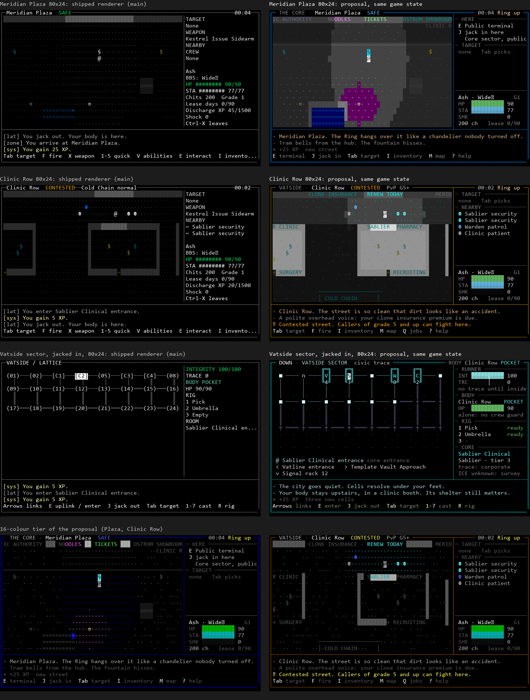
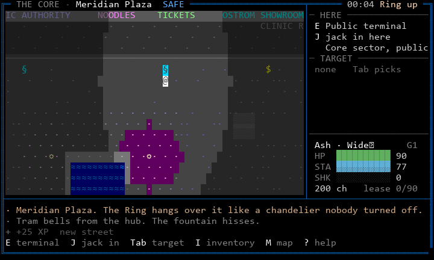
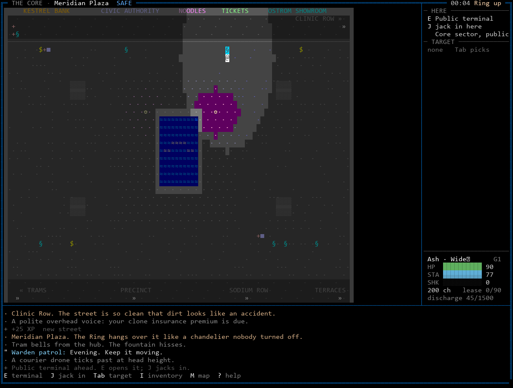
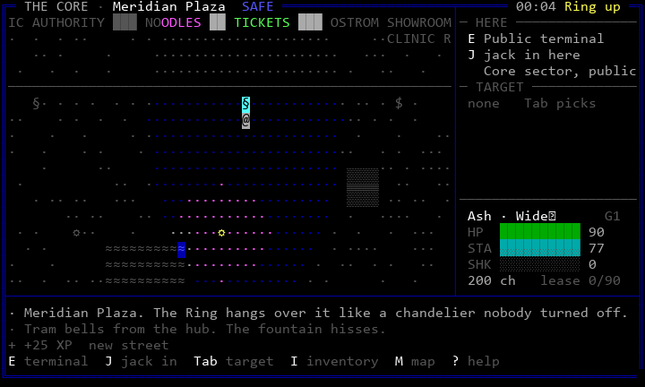
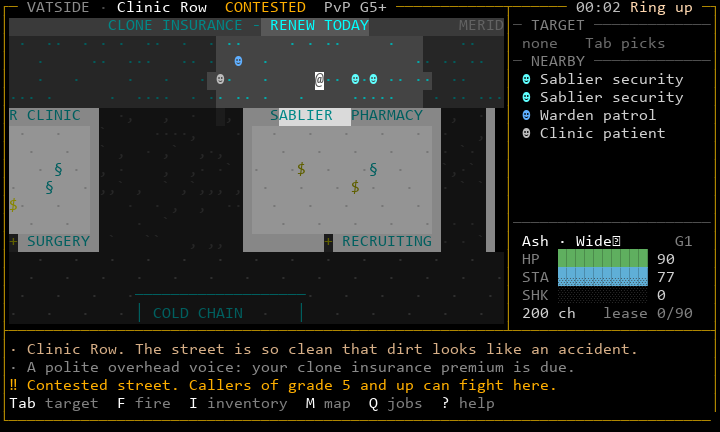
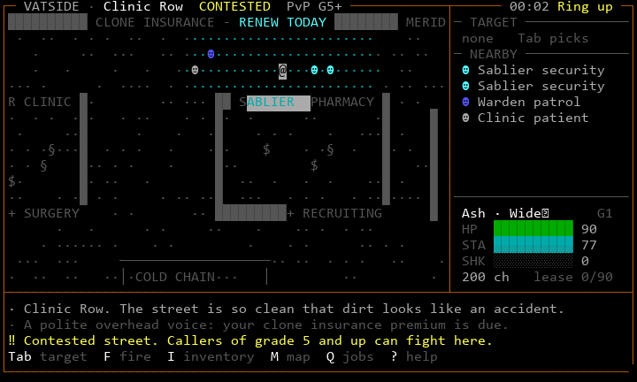
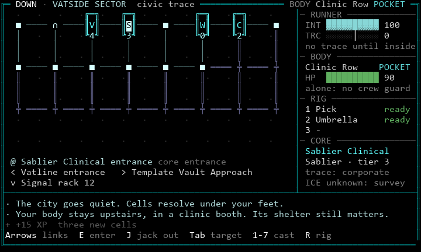
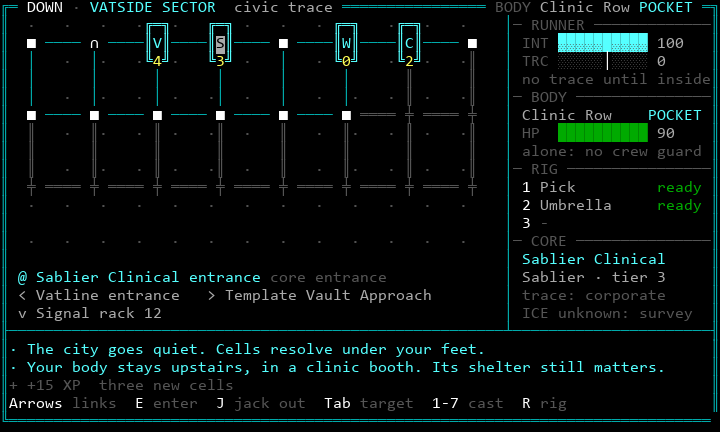

# Presentation direction for Karst (issue #68)

**Status: proposal.** Nothing here is canon until the decisions in
section 7 are accepted and the listed spec sections change, top-down,
per `AGENTS.md` section 2. The game's rules, numbers, sight, movement,
combat, Lattice access and trace are untouched by everything below.

**Review, 2026-10-24.** The owner approved the visual direction (the
grammar, lighting, signage, known-space dimming, panels and log shown
in section 8 and in the 132x50 Sodium Row dashboard frame). The owner
did not approve a final layout. Two points stay open:

- **Geometry.** Lighting and signage transform the look, but the
  underlying maps are still mostly open rectangles. Lamp pools do not
  replace the architecture the gazetteer describes (alcoves, alleys,
  terraces, platforms). Geometry is content with mechanical effect, so
  it belongs to S25 under its human layout gate (section 10, phase 6).
- **Artwork prominence.** A large vignette above the map is attractive
  but may cost attention and map rows in dangerous real-time play. The
  working hypothesis: large art on entering a location or on an
  explicit look, the tactical map first during active play. This is
  settled by playtests, not by static comparison (decision D8).

Contents:

1. What a caller sees today
2. The brief: one principle, four rules
3. Visual grammar
4. Places: districts, safety, contested space
5. Screen hierarchy and the log
6. The Lattice
7. Decisions this needs (spec and canon changes)
8. Mockups
9. Implementation changes
10. Rollout plan
11. Human acceptance criteria

---

## 1. What a caller sees today

Played on `main` at d80dacd (S01 to S24) through the shipped door
renderer, 80x24 and 132x50, 256 colours: the Wake, the training drone,
the tutorial terminal, Clinic Row, Sablier Boulevard, Meridian Plaza.



Evidence, in the order a new caller meets it:

- The first world log line a new Wake reads is an operator notice:
  "Crews end on a service restart. Use G to invite."
- The briefing (well written) is squeezed into the 55-column map area
  beside an empty side panel.
- The training drone draws as `@`, the same as you. `actor-drone` is
  missing from `glyphs.json`, so the view falls back to `@`.
- A jacked-in body draws as `▒`, the cover-2 shape.
- Every object reaches the client with role `text`, so terminals,
  hardware, doors and the relay are all the same white.
- Every zone is a radius-12 disc of grey dots on black. At 132x50 about
  85 per cent of the Meridian Plaza viewport is black. Remembered space
  differs only by the faint attribute, which many terminals ignore.
- The renderer never sets a background (`palette.py` builds
  `Style(color, 0, ...)`). Clinic Row ("logo in cyan on white") and
  Meridian Plaza ("neon in every colour") look the same; only the
  header word differs.
- Map files can only say rules (wall, floor, cover, water, anchors).
  Clinic Row has no alleys behind the clinics. Two thirds of it, and
  most of the 90x40 Plaza, is undifferentiated floor. The S25 Sink
  Terraces are a grid of solid blocks.
- The side panel is a flat list. Lease days, discharge XP and the BBS
  handle weigh as much as HP. Bars are `########`.
- The log prints "You gain 5 XP" in bright yellow and narration in grey.
  "Select a visible target with Tab." repeated 13 times and pushed the
  kill line out of view.
- Pressing E on the tutorial terminal opened the outfitter next to it.
  Nothing on screen said which object E would use.
- The Lattice is an 8x3 grid of numbered nodes, grey, in the same frame
  as the street. Names appear only for the current cell.
- Zone atmosphere text appears as the first line only, in an 8-second
  toast on the separator row.

Diagnosis: the pipeline has a channel for rules (tiles) and a channel
for prose (zone text), but nothing for **place**: how a location looks,
how it is lit, what it says. Every format, view field and renderer
carries rules only, so every author produced rules only. Better symbols
alone would not fix this; the missing layer has to exist.

## 2. The brief: one principle, four rules

**Shape is the rule; light and colour are the place.**

A glyph's shape always means a game rule and never changes by district.
Background colour, foreground hue, texture and lettering say where you
are, and never mean a rule.

1. **Rules keep their shapes everywhere.** `█` stops movement and sight.
   `░▒▓` are cover, darker for more. `≈` is water, `‼` hazard, `+` a
   door, `»` an exit. The shapes of interactables and people are
   reserved. No dressing may use a reserved shape.
2. **Places are lit, not drawn.** A district is its ground colour, its
   wall faces, its signage and its light pools. Dressing is always
   walkable, never cover, never opaque, and never changes a rule.
3. **Sight is brightness, not existence.** What you see now is fully lit
   and shows people and changing state. What you know but cannot see is
   the same place, dimmer, with no people and no state. Darkness means
   unknown, not unseen.
4. **Every screen answers the same four questions without scrollback:**
   where am I and how safe is my body; what is here and what will E do;
   who is near and what are they; what do I have left. (This restates
   `03-terminal-ui.md` section 11.)

Constraints this brief accepts as hard:

- CP437-drawable glyphs only, single width, no new runtime dependency.
- The 80x24 geometry of `03-terminal-ui.md` section 2 is unchanged.
- Three tiers. The 16-colour tier uses backgrounds 0 to 7 only, and uses
  SGR reverse rather than swapping in a bright background.
- No information by colour alone (section 8 of the UI spec).
- No animation. The client still renders only when a view arrives.

## 3. Visual grammar

### 3.1 Luminance ladder

Four bands, darkest to brightest. Each layer must stand out from the
one below it in every theme and tier (a contrast test enforces this).

| Band | What | How |
|---|---|---|
| Ground | floor, paving, paint, puddles | background colour plus sparse low-contrast texture |
| Structure | walls, facades, signage | wall background; signage letters lit on it |
| Things | interactables, cover, hazards, exits | bold, fixed glyph, kind colour on the ground |
| People | you, callers, NPCs | brightest; you are reverse video and never confused |

### 3.2 Terrain and structures

| Element | Glyph | 256 / truecolor | 16 colours |
|---|---|---|---|
| Floor | theme texture (`·∙,` or blank) | theme background, dim texture | `·` in theme colour on black |
| Wall | blank cell on wall background | wall background per theme | `█` light grey |
| Facade sign | letters on wall cells | neon/brand colour on wall background | letter colour on a 0-7 background |
| Floor paint | `─│` lines, letters, `«»` | dim paint colour on ground | dark grey |
| Cover 1-3 | `░▒▓` | cover colour; named in HERE ("planter", "bollard") | same |
| Water | `≈` | water background; glint cells may change colour, never shape | blue |
| Hazard | `‼` | amber on dark red background | bright yellow |

Letters belong to signage and paint only. No rule, actor or object uses
a letter on the map.

### 3.3 Things you can use

| Kind | Glyph | Colour role |
|---|---|---|
| Lattice terminal, descent console | `§` | cyan family |
| Vendor, bank counter | `$` | gold |
| Hardware | `■` | violet |
| Door / locked door | `+` / `≡` | brass |
| Exit | `»` | white, plus a painted or signed destination |
| Relay | `Ω` | the owning faction's colour; neutral when unowned |
| Light source | `☼` | warm white, inside its light pool |
| Clone vat | `Θ` | vat green |
| Dropped cache | `*` | gold |

The object E would use now is drawn reverse video and named in the side
panel's HERE section and on the hint line. The server already chooses
that object; the view only has to say which one.

### 3.4 People

| Who | Glyph | Colour |
|---|---|---|
| You | `@` | reverse video, white block |
| Other callers | `☺` | by relation (crew, neutral, hostile, Marked) |
| Civilians, patients, commuters | `☻` | soft grey |
| Wardens, including patrols | `☻` | Warden blue |
| Faction security | `☻` | faction colour |
| Hostile NPCs | `☻` | red |
| Drones | `τ` | by relation |
| A jacked-in body | `☺` or `☻` reverse in its colour | never a cover shape |

Light-ground variants (`@light` roles) keep people readable on white
clinic floors. A nearby list entry repeats the glyph in its colour, plus
the relation tag from UI spec section 8.

### 3.5 Visible and known space

| State | Terrain | People and state |
|---|---|---|
| Seen now | full theme colour | shown |
| Known (remembered or charted) | same hues, about 55-60 per cent light | never shown; public anchors keep their glyphs |
| Unknown | blank | never shown |

The 16-colour tier cannot dim. There, known space is dark grey, and
known ground shows one dot in three instead of every cell.

**Charted** (decision D1) means a public zone's layout is known on
arrival, as anyone in Karst knows Meridian Plaza. Sight still decides
which people and states you see. Without D1 the Plaza stays a disc until
walked, which the mockups show is the main reason it reads as a cave.

## 4. Places

### 4.1 District themes

Each district gets a theme: ground, wall face, texture, signage
palette, light pool colour, and the brightness of its known-space
version. Regions inside a zone (an alley, a clinic interior, a loading
yard) override it.

| District | Ground and light | Signage | Texture and feel |
|---|---|---|---|
| The Spire | polished slate, even amber light | Halvard amber, gunmetal | no texture; precise, quiet |
| The Core | wet slate paving, magenta and amber lamp pools | neon in every colour, Warden blue | sparse paving dots; lane paint |
| Vatside | white clinic interiors, teal-lit street, dark alleys | Sablier teal on white panels | bare and clean; alleys dirty |
| Tramyard | sodium-amber yards | Kestrel orange on black | rail paint, hazard stripes, dense texture |
| The Sink | red-black, half the lamps out, darker by terrace depth | Sable red | cable shadows, rubbish |
| Chapel Ward | cool grey, violet light | Choir violet and gold | almost no texture; very clean |
| Old Works | green-grey decay | Unmoored green, hand-painted | rubble and taped-cable texture |
| The Terraces | warm, muted residential | plain block numbers | doorsteps, drying lines |
| Sodium Row | saturated pink and amber pools everywhere | neon, Sable red accents | crowded, loud |
| Undercity | no ambient light; uncharted | none, or stencils | damp blue-black; Exhale warms it |
| The Scour | bone and rust under the Ring | Ferrymen rust | dust; Ring-fall glints |

### 4.2 Safety classes

The frame tells you how safe your body is, in shape, colour and word:

| Class | Frame lines | Frame colour | Header word |
|---|---|---|---|
| safe | double `═║` | Warden blue | SAFE |
| pocket | double | teal | POCKET |
| contested | single `─│` | amber | CONTESTED, plus `PvP G5+` |
| open | single | red | OPEN |

Pockets inside contested zones are lit interiors: Clinic Row's clinics
are white, its street is dim teal and its alleys are dark. You can see
the boundary before you cross it, and the frame and header change when
you do.

### 4.3 Contested space

- The header carries the zone's live facts: relay and service state
  ("Cold Chain normal"), PvP eligibility, and your Marked or heat timer
  as a word and digits.
- The relay glyph `Ω` is in its owner's colour. A capture in progress is
  reverse video plus a timer in HERE.
- Territory is visible in the place itself: an owner-coloured accent in
  the district's signage and light. A region's sign colours can carry
  the relay owner's colour without changing the authored text. This
  needs S21's territory state in the view (one field).
- Danger lines (contested entry, hazards, Marked) use the `‼` gutter
  and amber, and are never coalesced away.

### 4.4 Dressing content

Per zone, a `presentation` block in the zone sidecar (or a sibling file)
with:

- `theme`, plus `regions` (rectangles or circles) that override it;
- `signs`: text runs that may only sit on wall cells;
- `marks`: paint lines and letters that may only sit on plain floor;
- `glints`: water or light cells whose colour, never shape, changes;
- `charted`: true for public hubs if D1 is accepted;
- names for cover and anchors shown in HERE.

`scripts/presentation_mockups/presentation.json` is a working example
for Meridian Plaza and Clinic Row.

## 5. Screen hierarchy and the log

### 5.1 Header

`THE CORE · Meridian Plaza  SAFE  ...  00:04 Ring up`. District (dim),
zone (bright), safety word (in its colour), then live zone facts, then
the clock, then a night line when the Ring is up. Lower-priority
segments drop first at 80 columns.

### 5.2 Side panel (22 columns)

Top to bottom, each section introduced by a dim rule with its name:

1. **HERE**: what E does now, and any other key the spot offers ("J
   jack in here"). Shown only when there is something.
2. **TARGET**: name, relation tag, HP bar, range, cover. "none   Tab
   picks" when empty.
3. **NEARBY**: glyph in its colour, then name. It shrinks first when
   space is short.
4. **CREW**: only when you have one.
5. **Pinned to the bottom**: name (and the handle only if it differs),
   grade, HP, STA and SHK bars (`█▌░`, 10 cells, digits after), chits
   and lease days. At 132x50 add discharge progress and standing.

The weapon line moves into TARGET (the weapon you would fire). Shock
gets a bar, because it is a threat. Discharge XP leaves the 80x24 panel
and stays on the character sheet.

### 5.3 The log

| Kind | Gutter | Colour | Example |
|---|---|---|---|
| place | `∙` | warm | Meridian Plaza. The Ring hangs over it like a chandelier nobody turned off. |
| ambient | `∙` | dim grey | Tram bells from the hub. The fountain hisses. |
| speech | `"` | speaker lit, line white | Warden patrol: Evening. Keep it moving. |
| combat | `*` | white | You hit the drone. 12. |
| danger | `‼` | amber | Contested street. Callers of grade 5 and up can fight here. |
| system | `+` | dark grey | +15 XP  three new cells |
| lattice | `∙` | sector colour | The city goes quiet. Cells resolve under your feet. |

Rules:

- On first entry to a zone, a place line replaces the toast: the first
  sentence of the zone text. Later entries print only the zone name.
- Ambient lines come from zone content, at most one per 60 to 120
  seconds per caller (seeded per zone instance), and stop while you are
  in combat. Log verbosity, a setting the UI spec already lists but the
client does not implement yet, can mute them.
- Identical lines within 10 seconds coalesce: `Select a visible target
  with Tab. (x13)`.
- XP gains within 5 seconds merge into one dim system line.
- Operator notices (service restarts, crews) go to the title screen or
  the relevant menu, never to a new Wake's world log.
- No brackets. The gutter glyph and colour carry the channel, and chat
  channels keep their existing names when shown.

## 6. The Lattice

Going down must look like the city going quiet. Meatspace is filled
colour; the Lattice is **linework on black**.

- **No background fills** anywhere in a sector or core. A faint grid of
  dots shows the field the old engineers laid out.
- **The owner's light.** Lit (public) cells are bright `■` in the
  sector's colour: Sablier white-cyan, Halvard amber, the Sink red with
  some links drawn unlit.
- **Gated cells have a line through them:** `╪`, unlit, with `═║`
  links. Hidden cells, once found, are `∙` with dotted links. An uplink
  is `∩`; a descent cell is `∞`.
- **Cores are buildings:** a 3x3 box `╔═╗ ║S║ ╚3╝` in the owner's colour,
  with an initial and the tier. Known black ICE turns the tier digit red.
- **You** are the reverse-video cell.
- **Words, not numbers.** Below the field: where you are and what it is,
  then each link as a direction and a name (`< Vatline entrance  >
  Template Vault Approach  v Signal rack 12`). The `(nn)` numbering
  goes.
- **The frame shows your body's safety,** not the sector: double teal
  for a pocket, and so on. The header reads `DOWN · VATSIDE SECTOR ·
  civic trace` on the left and `BODY Clinic Row POCKET` on the right.
- **Panel:** RUNNER (integrity bar; trace bar with the 50 threshold
  marked, and the next consequence in words), BODY (place, safety, HP,
  who guards it), RIG (slots, cooldowns), CORE or ROOM (owner, tier,
  trace policy, ICE as named bars once surveyed).
- **The Silt** (described, not mocked): violet on black, with the field
  grid gone. Cell labels degrade toward the lower bands (`Sh?llows`),
  the riser is always drawn, and the band name and depth sit in the
  header.

## 7. Decisions this needs (spec and canon changes)

None of these is adopted by this document. Each needs your decision,
then a spec edit at the right level of the hierarchy before any code.

| ID | Decision | Changes |
|---|---|---|
| D1 | Charted public geography: safe and pocket hubs (and any zone flagged `charted`) show known terrain on arrival; sight still gates people and state | `03-terminal-ui.md` section 2 ("never-seen tiles are blank"); `02-architecture.md` section 5.4 note; gazetteer flag per zone |
| D2 | Known space is the place dimmed, not a grey ramp; 16 colours use grey and sparse dots | `03-terminal-ui.md` section 2 |
| D3 | A presentation layer in content: themes, regions, signs, marks, glints; validator rules | `04-assets.md` sections 3 and 9; `01-entities.md` zone format |
| D4 | Backgrounds as a first-class colour use; 16-colour backgrounds 0-7 only; safety shown by frame line style; safe colour becomes Warden blue (today green) | `03-terminal-ui.md` sections 1, 2, 8; `palette.json` roles |
| D5 | Log kinds, place lines, ambient lines with a rate limit and mute, coalescing, operator notices out of the world log | `03-terminal-ui.md` sections 2 and 10; game design log section; S27 scope |
| D6 | Glyph registry additions (`τ ∩ ∞ ╪ ╤ ╧ ╟ ╢ ▌ ∙ « , \``, signage letters), and a rule that new glyphs come from CP437 0x80-0xFE | `03-terminal-ui.md` section 1; `glyphs.json` |
| D7 | Lattice: no fills, owner light, named links, frame shows body safety | `03-terminal-ui.md` section 3; `03-lattice.md` section 1 already agrees |
| D8 | Layout tiers and artwork prominence: a 132x50+ dashboard (district schematic, richer panels, feed with location) and when location art may take screen space. Open; decided by playtest (below) | `03-terminal-ui.md` sections 2 and 7; `04-assets.md` section 4 (art sizes); S33 scope |

**D8 playtest.** Build the art modes as a client setting so one build
can compare them: (a) no strip, art only on entry and on a look key;
(b) slim strip (6-8 rows) that collapses when a hostile is targeted, a
hazard warns, or the caller is hit; (c) fixed strip. Same scripted
routes for each (a Sodium Row walk, a contested-street fight, a Clinic
Row relay job), at 80x24 and 132x50. Measure time to notice a threat,
missed hazard warnings, deaths, and the caller's stated preference.
Art never delays an escape action or covers a timed hazard in any mode
(`04-assets.md` section 9 already requires this).

Also verify, not decide: whether any NetBBS transport sends output as
CP437 bytes. If one does, glyphs whose CP437 codes are terminal
controls would misbehave: `•` (0x07 BEL), `◘` (0x08), `○` (0x09),
`◙` (0x0A), `♪` (0x0D) and `←` (0x1B ESC). The registry uses `•` and
`←` today. This belongs to S31's real-transport acceptance.

## 8. Mockups

All mockups are built by `scripts/presentation_mockups/build.py` from
real game state:

- A headless server (the production simulation through the test
  harness) creates a Ghost called Ash. The caller's handle is `Wide界`,
  so a wide character is always on screen.
- Ash walks Clinic Row through a clinic, jacks in at its public
  terminal, comes out, then walks Sablier Boulevard into Meridian
  Plaza. The real camera, sight, memory, NPC spawns and view bodies are
  used throughout.
- Each scene is drawn twice from the same body. The `-before` file comes
  from the shipped door renderer. The proposal comes from `proto.py`,
  which uses the door's own `CellBuffer`, `Style` and `layout.compute`.
- Every frame is replayed through `tests/fake_terminal.py`. That replay
  rejects control characters and any write to the bottom-right cell.

Files per scene: `.ans` (the exact bytes a terminal receives), `.txt`
(cell text) and `.png` (a screenshot of that replay, for review only).
To see a mockup on a real terminal at 80x24 or larger:

```
python -c "import sys; sys.stdout.buffer.write(open(sys.argv[1], 'rb').read())" docs/design/proposals/68-presentation/mockups/clinic-row-80x24-256.ans
```

What is real and what is proposed in each frame:

| Real (today's view bodies) | Proposed (computed by `proto.py` from `presentation.json`) |
|---|---|
| viewport, visible tiles, remembered tiles, legend | theme, regions, signs, marks and glints per cell |
| actors and their roles, nearby list, objects | charted terrain (D1), known dimming (D2) |
| me (HP, STA, shock, chits, lease, grade, clock, safety) | HERE focus (the server already picks the E target) |
| service state, LatticeView cells, edges, rig, body safety, core content | log lines marked place/ambient; header layout |

The log lines in the mockups are proposals. "Warden patrol: Evening.
Keep it moving." stands in for S27 dialogue.

### 8.1 Meridian Plaza, 80x24



Ash stands at the second public terminal. The Plaza is charted (D1), so
the paving, the planters (`▒`), the fountain and both lamps are known.
The part Ash can see is lit: brighter paving, the magenta lamp pool, the
fountain rim. The north facades carry the Civic Authority, NOODLES,
TICKETS and the Ostrom Showroom (the bank is off-screen to the west). "CLINIC ROW »" is painted where
Sablier Boulevard leaves. HERE says what E and J do. The frame is double
Warden blue: safe.

At this moment the real NPCs were out of sight, so NEARBY is absent.
That is honest, and it is a finding: Plaza spawners put all civilians in
one 18x6 corner (see 9.4).

132x50, the same walk:



The whole Plaza is legible: the lane paint, the four southern exits with
painted destinations, the facade signs, the Ring glinting in the
fountain. The patrols had walked out of sight, so NEARBY is empty here
too. The log has room for place, ambient, speech and system lines.

16 colours (backgrounds limited to black and one grey):



### 8.2 Clinic Row, 80x24



Ash is on the boulevard outside the pharmacy. Sablier security (teal),
a patient (grey) and a Warden patrol (blue) are real spawns. The
clinics, walked through earlier, are known: white interiors, dimmed,
with their counters and terminals. The facades read SABLIER CLINIC,
SABLIER PHARMACY, SURGERY and RECRUITING. The alley between the clinics
is darker than the street. To the south the Cold Chain bay is painted on
the yard. The frame is single amber, and the header says CONTESTED,
PvP G5+ and Cold Chain normal.

What dressing cannot do here: the gazetteer's "alleys behind the
clinics" do not exist in the map. That needs geometry, which changes
movement and sight. It belongs to S25 under human layout approval, not
to this rollout.



### 8.3 The Lattice: Vatside sector, 80x24



Ash is at the Sablier Clinical entrance, body in a clinic booth on
Clinic Row. The cores are buildings with initials and tiers: Vatline
4, Sablier Clinical 3, Wake Hall 0, Cold Chain 2, all real content
values. Public cells are lit, the gated rows are unlit with
lines through them, and the uplink is `∩`. Below the field the links are
named. The frame is the body's: double teal, POCKET.

The sector content itself is a placeholder grid ("Signal rack 12").
`03-lattice.md` names Vatline Queue and Clinic Scheduler. A label and
position pass on sector content is part of phase 4 (IDs and topology
unchanged).



## 9. Implementation changes

Grouped by component. Nothing in this list changes a rule, a number, a
sight radius, a passability or opacity value, or a protocol field
already in use. View changes only add fields.

### 9.1 Content and validation

- `palette.json`: background-capable roles; theme roles; `@light` actor
  and object variants; frame, word and log roles; deutan and protan
  values for every new role.
- `themes.json` (new): district and region themes per tier.
- Zone `presentation` block (D3) and a validator that checks:
  - signs sit on walls and marks on plain floor, and dressing glyphs are
    never in the reserved rule set;
  - glyphs are CP437 0x80-0xFE or ASCII;
  - 16-colour backgrounds are 0-7;
  - every theme passes a contrast floor between the ladder bands, for
    both dark and light actor roles.
- `glyphs.json`: add `actor-drone` (`τ`); change `actor-jacked` off `▒`;
  add the Lattice glyphs (D6).
- Sector content: real labels for placeholder cells, and authored
  positions when the topology allows.

### 9.2 Server view model (additive only)

- `ZoneView.looks` and `looks_legend`: per viewport cell, an index into
  resolved looks (glyph, fg role, bg role), filtered exactly like
  `tiles`, so dressing never reveals unseen geometry. For charted zones
  (D1), `remembered` is filled from the template on entry.
- `ZoneView.focus`: `{id, label, verb}` for the object E would use now,
  and the J target where it applies.
- Object `role` by kind (today every object is `text`).
- `me` additions the header needs: district name, PvP eligibility,
  Marked or heat seconds. Most already exist.
- `LatticeView`: per cell `owner` and `tier` for cores, the sector
  theme id, and link labels. The data already exists in content.
- Log lines carry `kind` (place, ambient, speech, combat, danger,
  system, lattice). Ambient emitter seeded per zone instance. Place line
  on first entry. Coalescing stays client-side.
- Move the crew restart notice off the world log.

### 9.3 Door client (rendering only)

- `Palette.style` accepts a background role. Add the known-space dimming
  function (256 nearest-index, truecolor scale, 16 grey). In the 16
  tier, reverse uses SGR 7.
- Frame line style and colour by safety. Header segments with drop
  order.
- Side panel per 5.2, with bars of `█▌░`.
- Log: gutters, kinds, colours, coalescing, XP merge.
- The hit flash recolours the box-drawn frame for one frame instead of
  drawing `-` and `|`.
- Lattice renderer per section 6.
- Text views (Wake briefing, help) use the full width, not the 55-column
  map area.

### 9.4 Content authoring and placement (S25, S27)

- Presentation blocks for the ten S08 hub zones, then every S25 zone.
- Spawner regions spread through each space (the Plaza's civilians all
  start in one corner today).
- Ambient lines per zone (S27).

## 10. Rollout plan

Built so Astra can implement each step without touching mechanics, and
so a reviewer can verify that.

**Guard, first PR of phase 1: a mechanics fingerprint test.** For every
shipped zone and sector, hash the rule grid (passable, opaque, cover,
hazard, exits, object tiles) and the rule fields of a scripted
ZoneView/LatticeView walk (tiles, remembered, actors, objects ids and
states, me numbers, trace). Every later phase must leave these hashes
unchanged. The only allowed difference is new fields. If a change needs
a hash to move, it is out of scope and goes back to the issue.

| Phase | Who | Content | Depends on | Done when |
|---|---|---|---|---|
| 0 | Claude (Opus/Fable), you approve | Decisions D1-D7; edit the spec sections listed in section 7, top-down | this proposal | spec PR merged |
| 1 | Astra | Client foundations: background roles, frame by safety, header, side panel, bars, log kinds and coalescing, hit flash, 16-tier reverse; fingerprint guard | 0 | golden screens at 80x24 and 132x50, three tiers, wide handle; fingerprint green |
| 2 | Astra | Grammar fixes: drone and jacked glyphs, object roles by kind, `focus` and HERE, E/J on the hint line | 1 | E never opens an unnamed object in the Wake Hall acceptance |
| 3 | Astra | Presentation layer: format, validator, `looks` grid, known dimming, charted zones (if D1); author Meridian Plaza and Clinic Row from `presentation.json` | 1, 2 | the mockups in section 8 reproduce from live play |
| 4 | Astra | Lattice renderer and sector themes; sector label pass | 1 | the Lattice mockup reproduces; no `(nn)` labels remain |
| 5 | Astra with S27 | Voice: place lines, ambient emitter and content, operator notices moved, XP merge | 1 | new-Wake script shows no operator notice in the world log |
| 6 | S25 owner, human review | Presentation blocks for the other eight hub zones, then each S25 district; spawner spread; geometry changes only under S25's layout approval | 3 | each district passes section 11 at both sizes |
| 7 | Human, S31 | Real NetBBS: Telnet (SyncTERM, CP437 check), SSH UTF-8, web xterm.js; deutan and protan | 1-6 | section 11 signed off |

Ownership across slices, as issue #68 asks:

- **S25:** district presentation and any geometry, under its existing
  human gate.
- **S27:** ambient lines and NPC voice.
- **S30:** onboarding screens, the Wake text layout, settings for log
  verbosity and palette variants, help for the new legend.
- **S31:** real-transport acceptance, including the CP437 check.
- **S33:** title, vignettes and transitions. S33 does not solve map
  legibility and is not a substitute for phases 1-6.

Not in this plan: the City Map overview (M). It still shows lists. A
schematic district map is its own follow-up under #68.

## 11. Human acceptance criteria

Run at 80x24 and 132x50, in 256 and 16 colours, with a wide-character
handle, through a real NetBBS node. The reviewer has not read this
document.

1. Shown three frames with the header cropped, the reviewer tells
   Meridian Plaza, Clinic Row and the Lattice apart.
2. Within five seconds of a frame, the reviewer finds themself, names
   every interactable in view, and says what E will do.
3. The reviewer names each person's class: caller, civilian, Warden,
   faction security, hostile, drone.
4. The reviewer states the safety class from the frame alone, then from
   the header word.
5. The reviewer says which part of the map is seen now and which is only
   known, and expects people only in the seen part.
6. The reviewer names the destination of every exit in view without
   opening a menu.
7. Jacked in, the reviewer says where the body is, how safe it is, the
   next trace threshold and its consequence, and where each link leads.
8. In the first five minutes of a new Wake, no operator notice appears
   in the world log. No danger or combat line is pushed out of the
   three-row log within ten seconds by ambient or system lines.
9. With the deutan and protan palettes, criteria 1 to 7 still pass.
10. On Telnet in CP437 mode, SSH and the web terminal, no glyph is
    missing, replaced or misbehaving.

Passing tests, validation or code review does not grant these. They are
the renewed human review issue #68 asks for.
