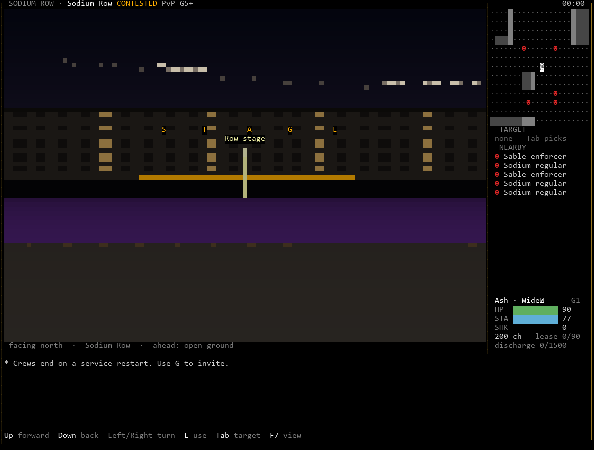
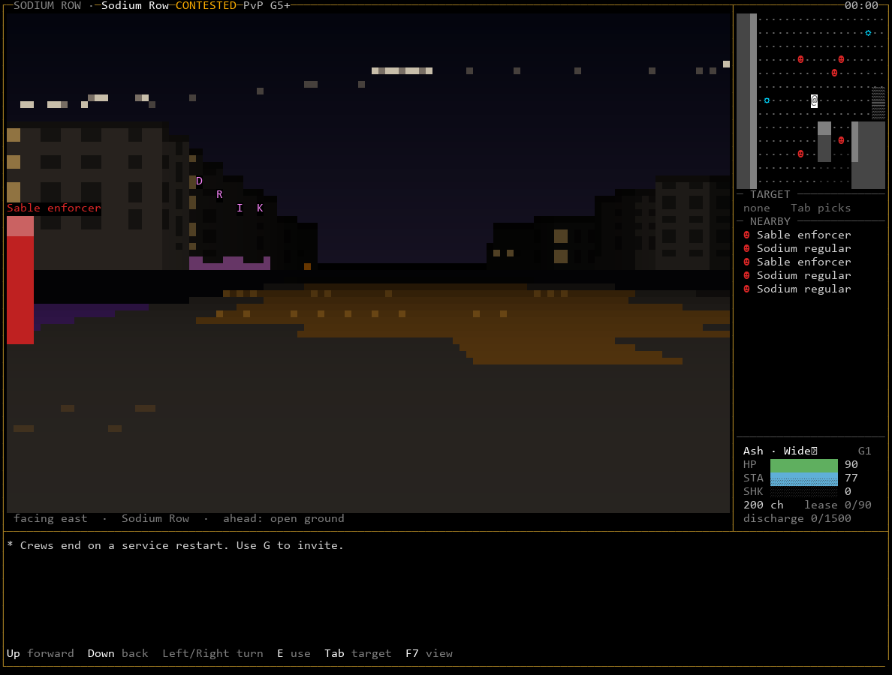
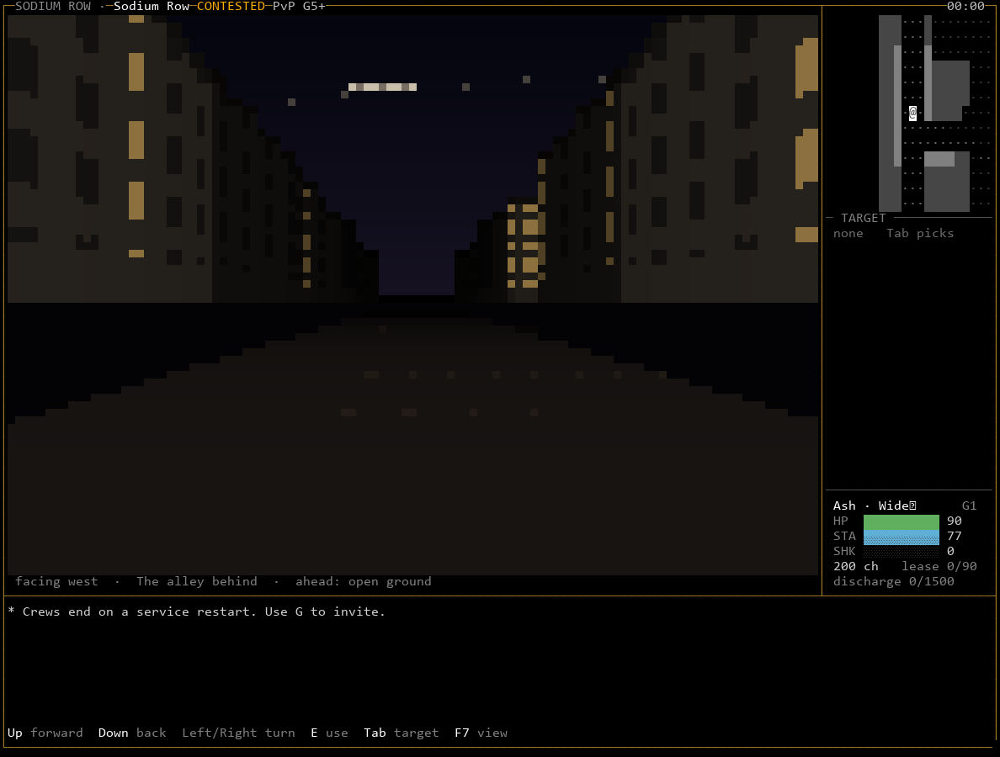
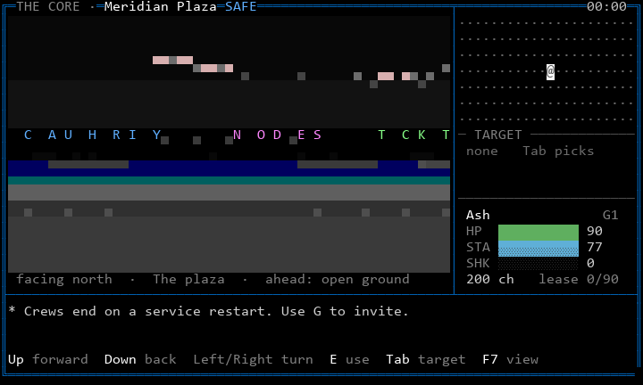
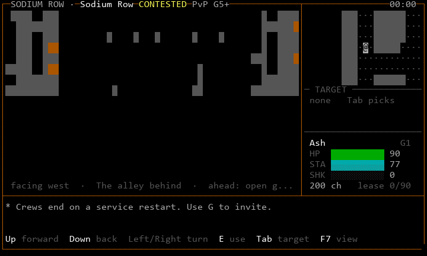
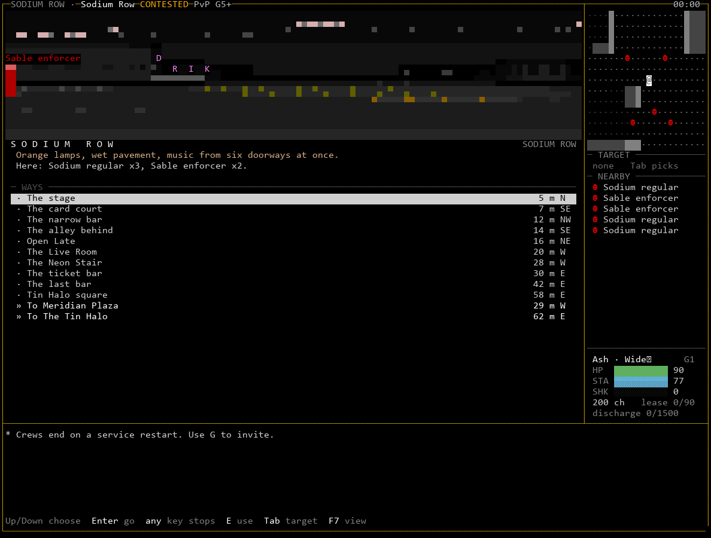
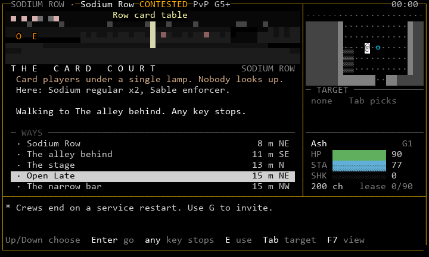
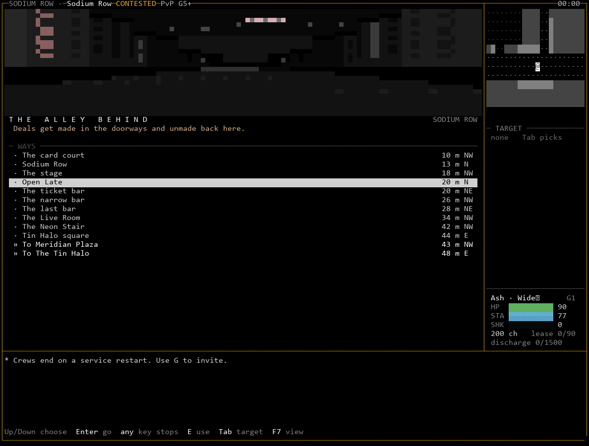
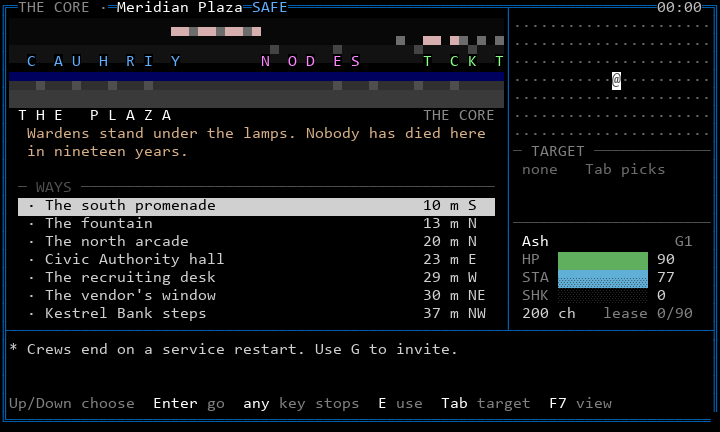

# Beyond the roguelike map: two playable paradigms (proposal)

**Status: exploration for the owner, issue #68.** Not canon and not a
recommendation to replace anything yet. Both prototypes run in the trial
build beside the shipped map and the proposal map (`spec.md`), on the
same server, the same simulation and the same combat. F7 cycles all four
views on one game state.

```
python scripts/playtest_68.py --geometry candidate --view street   # A: eye level
python scripts/playtest_68.py --geometry candidate --view scene    # B: places
```

## 1. The question

The proposal map (`spec.md`) makes Karst legible and lit, and it is
still a top-down grid of glyphs: a roguelike. That is not a failure of
polish. The top-down map is a paradigm with a fixed relationship
between the player and the world, and some of what the owner asks for
sits outside it.

What the top-down map does better than anything else:

- **Tactics.** Exact positions, lines of fire, cover, distances, who is
  behind you. Blacksite's combat is built on this and must keep it.
- **Honesty.** What you see is what the server says you see, cell for
  cell. Nothing is implied.
- **Speed.** One keypress, one tile, no ambiguity.

What it cannot do, however it is lit:

- **Presence.** You are a symbol looking down at other symbols. Nothing
  is ever *in front of* you, *above* you or *at the end of the street*.
  The gazetteer's Sodium Row is "orange lamps, wet pavement, music from
  six doorways"; on a map it is a coloured rectangle you stand on.
- **Scale and verticality.** Karst is towers, terraces, a Ring overhead.
  A plan view has no height and no sky.
- **Places as places.** The map knows tiles; people think in places: the
  stage, the alley behind the bars, the Halo's door. A map makes you
  navigate coordinates, not intentions.
- **Narrative framing.** RPG moments (arriving somewhere, being in a
  bar, choosing where to go next) have no shape of their own on a grid.

So the question is not "how do we make the map nicer?" but "what other
relationship between player and world can a terminal sustain, while the
spatial simulation and tactical combat stay exactly as they are?"

## 2. What stays fixed

Both prototypes are views over the unchanged server:

- the same zone grid, sight, memory, movement rules, cooldowns, combat,
  hazards, NPCs and Lattice;
- the same authorized view bodies (plus the additive presentation fields
  in `spec.md` 3.3);
- the tactical map as the screen of danger: in both prototypes any
  threat (a hazard, a target, a hostile, combat, heat) hands the screen
  to the proposal map, labelled TACTICAL, with absolute arrow keys. They
  are exploration and place paradigms, not combat paradigms.

Each needed exactly one new server affordance, both trial-only behind
`BLACKSITE_PRESENTATION_TRIAL`:

| Affordance | Used by | What it does | What it does not do |
|---|---|---|---|
| `view_shape` (deep camera) | A, B | the view covers as far north and south as east and west (up to the 4096-cell budget), so you can see down a street | it does not widen sight: unseen tiles stay unsent |
| `walk_to` | B | the server walks your body to a known tile, one ordinary `move` per movement cooldown | no speed-up, no teleport, no route through ground you do not know; any key, a hit, a fight or a blocked way stops it |

## 3. Prototype A: street view (eye level)

**What it is.** A first-person view of Karst at street level, drawn
from the tiles the server sent. Two pixels per terminal cell (`▀`), a
grid raycaster in the door. Buildings stand 2.4 tiles tall, with
rooflines against a night sky where the Ring hangs as a band of debris.
Facades take the district's colours from the looks layer; signs glow at
street height and their letters are written across the facade; upper
storeys have windows, some lit. The ground is cast from the same looks:
lamp pools, the card table's felt, puddles, cover, warned hazard tiles.
People and things stand where the server says, as figures and shapes,
with names over the near ones. Unknown space is darkness; remembered
space is drawn at half light, without people.

**Controls.** Up walks forward, Down steps back, Left and Right turn.
Turning is the door's; a step is translated into the ordinary absolute
move, so the server receives exactly what the map would send. A small
radar in the side panel, turned so that ahead is up, keeps the tactical
picture. The line under the view says which way you face, where you are,
and what is in front of you.







**What it gives.** Presence. For the first time Sodium Row is a street
you are standing in: buildings on either side, lit windows, the Ring
above, a Sable enforcer close enough to read. The alley behind the bars
is a dark canyon. This is the paradigm closest to Neocron and to the
owner's sense of "entering a different reality", and it costs no
content beyond the looks layer: any dressed zone works.

**What it costs.**

- **Tactical blindness.** You see a 66-degree cone. Someone behind you is
  only on the radar. That is why danger switches to the map; the switch
  itself is a context change at the worst moment, and needs playtesting.
- **Orientation.** Turning is a new skill. Grid-locked 90-degree turns
  keep it simple but make the world feel coarse; smooth turning would
  need the server to know about facing.
- **Resolution.** At 80x24 the view is 55x32 pixels. Shapes read; detail
  does not. Signs are legible near, not far. 132x50 is much better.
- **16 colours.** Whole-cell pixels in grey and a few hues: it reads as
  buildings and windows, and is clearly the weakest tier.
- **Cost.** Measured in the door process: 10 ms per frame at 80x24, 30 to
  39 ms at 132x50, against 5 and 13 to 15 ms for the map. A step redraws
  most cells, up to about 25 KiB at 132x50: fine locally and over SSH,
  heavy on a slow Telnet link.
- **Movement feel.** Walking forward one tile per step is honest to the
  simulation and slower to read than the map: the eye has to rebuild the
  picture each step.

## 4. Prototype B: scenes (places and intentions)

**What it is.** You are always somewhere with a name. The screen leads
with that place: a glimpse at eye level (prototype A's renderer, a
strip), the place's name, a line or two of its own text, who is here,
what is in reach (`E`), and a list of **ways**: other named places,
exits and things you know of, with distance and compass direction.
Choosing a way and pressing Enter asks the server to walk you there in
real time, through the simulation, step by step; the screen updates as
you go ("Walking to The alley behind. Any key stops."). The place
changes under you as you cross into it.

Places are content: `places` in the looks file, each a named rectangle
with a sentence and an anchor tile. The Plaza, Clinic Row and Sodium Row
(shipped and candidate) have them. A place is listed only when its
anchor is on ground you know, so the list of ways never maps unseen
space; on an uncharted contested street you start with very few ways.






**What it gives.** The RPG frame. Sodium Row stops being a rectangle and
becomes a set of places with names and purposes: the Live Room, the card
court, the alley behind, Tin Halo square. You move by intention ("go to
the card court"), not by counting tiles, and you arrive *somewhere*. It
suits safe hubs and social streets, where most time is spent choosing
where to go and whom to see. It gives writers a natural home (a place's
text, later its people and rumours), and it reads well at 16 colours
because it is mostly words.

**What it costs.**

- **Content.** Every zone needs authored places with names and text.
  Without them the paradigm has nothing to show. That is S25 and S27 work
  at roughly ten places per zone.
- **Distance from the body.** Walking by menu removes the skill and
  pleasure of moving. In contested space that matters: positioning is
  half of play. Scenes there must hand over to the map early, or the
  paradigm becomes a liability.
- **Menu drift.** If places are thin, a scene becomes a menu of
  destinations, which is a worse MUD, not a better RPG. The text, the
  glimpse and the people have to carry it.
- **A new mechanic.** `walk_to` is automation. It is honest (ordinary
  steps, known ground only, stops on anything), but it changes how a
  player can act and needs a decision (S1 below).
- **Ambiguity.** "Here: Sodium regular x3" hides who is where. That is
  fine at a bar and wrong in a fight, which is again why threat hands
  over to the map.

## 5. Side by side

| | Proposal map (`spec.md`) | A: street view | B: scenes |
|---|---|---|---|
| Feels like | a lit tactical map | being in the street | being somewhere, choosing where next |
| Best at | tactics, honesty, speed | presence, scale, atmosphere | RPG framing, hubs, social play, writing |
| Worst at | presence, places | awareness behind you, 16 colours | moment-to-moment movement, contested space |
| Content needed | looks per zone | looks per zone (same) | looks plus places with text per zone |
| Server change | additive fields | deep camera | deep camera, `walk_to` |
| Door CPU, 132x50 | 13-15 ms/frame | 30-39 ms/frame | 15-17 ms/frame |
| Bandwidth per step | small diff | most of the screen | small diff while walking |
| 16 colours | good | crude | good |
| Danger | native | hands over to the map | hands over to the map |

## 6. What I think it means

Neither prototype should replace the map. They answer different
moments, and the most promising direction is to stop treating "the
view" as one thing:

- **Arriving and looking** belong to the street view: the place card
  (spec 5.6) could become a street-view establishing shot of where you
  stand, the thing S33's vignettes were meant to be, but live.
- **Being in a hub** belongs to scenes: the Plaza, the Tin Halo, Clinic
  Row's interiors, Vesper's bar, the Lattice terminals' surroundings.
- **Danger and contested ground** belong to the tactical map, which both
  prototypes already fall back to.

A third prototype would test that: the door choosing the view from
context (safety class, threat, whether you are walking or standing)
rather than a key. I have not built it; it is a small step from here, and
whether it feels natural or jumpy is exactly what play has to show.

## 7. Decisions these raise

| ID | Decision | Why it needs you |
|---|---|---|
| S1 | Is `walk_to` (server-walked travel over known ground) acceptable as a mechanic, and where (safe hubs only, everywhere)? | it changes how players act and what a bot could script |
| S2 | Is the deep camera acceptable (larger views, more bandwidth)? | changes the view budget and the camera rule in UI 2 |
| S3 | Which paradigm, if any, becomes a supported view, and for which contexts? | product direction; affects S25, S27, S30, S33 scopes |
| S4 | Should facing become server state the view can set (smooth turning, facing-aware rules later)? | today facing is persisted but unused; making it meaningful is a rule change |
| S5 | Places as content: who writes them, and are they canon (gazetteer) or presentation (looks)? | names of places become world text |

## 8. Honest limits

- Built and captured from the harness; not yet played by a person. The
  user's own play is the test.
- Only three zones have places, and only the Sodium Row candidate has
  enough architecture for street view to show what it can do. On the
  shipped Sodium Row (an open rectangle) street view shows mostly open
  ground and distant walls: geometry matters more at eye level than on
  a map.
- The street view has no animation (no flicker, no rain, no moving
  crowds between server updates). It could; each would cost CPU and
  bandwidth and would need its own rule about never imitating a threat.
- The Lattice keeps its own linework view in both prototypes; going down
  is already a change of medium.
- Menus, text views and dialogue are unchanged.
