# Blacksite presentation: visual and interaction design (proposal)

**Status: proposed design contract, issue #68.** Not canon. When the
owner approves it (in whole or by the decisions in section 12), its
normative parts move into `docs/design/` as `05-presentation.md`, and the
canon lines listed in section 12.2 change first, top-down, in the same
PR (`AGENTS.md` section 2). Until then it binds nothing, and the playable
build in this branch is a trial behind switches.

**See also** [`paradigms.md`](paradigms.md): three playable alternatives
to the top-down map (street view, scenes, a context-driven auto view) and
their trade-offs.

**What this document is.** The contract for how Karst and the Lattice
reach a caller's eyes: the vision, the visual vocabulary, the layout and
information rules, the architecture that carries them, the acceptance
standards, and the decisions that need the owner. It consolidates the
#68 investigation (`README.md` in this folder), the approved visual
direction (2026-10-24), the Sodium Row dashboard experiment and the
playable trial.

**How to read it.** MUST, MUST NOT and SHOULD are requirements. Text
marked *Guidance* explains intent and leaves room for judgment. Section
11 lists the requirements as testable items (R1 to R40). Section 10 says
what is deliberately left to the author's taste.

Canon this document serves, highest first:

| Source | Sections used |
|---|---|
| World bible `docs/world/00-bible.md` | 2 (tone), 4 (geography), 5 (the Lattice), 7 (factions), 13 (canon boundaries) |
| Gazetteer `docs/world/01-gazetteer.md` | per-zone entries, especially `core-plaza`, `vatside-clinics`, `sodium-row`, `sodium-tin-halo` |
| Lattice `docs/world/03-lattice.md` | 1 (going down), 2 (sectors), 3 (cores), 7 (trace) |
| Game design `docs/design/00-game-design.md` | 1.1 (repeat-play contract), 5.1-5.3, 6.1-6.4, 7.3-7.4, 15 (accessibility and tiers) |
| Terminal UI `docs/design/03-terminal-ui.md` | 1 (tiers, glyph registry), 2 (layout), 3 (Lattice view), 6 (rendering), 8 (colour-blind), 11 (playable information) |
| Assets `docs/design/04-assets.md` | 3 (maps), 4 (ANSI art), 9 (content that expresses the rules) |
| Architecture `docs/design/02-architecture.md` | 5.4 (server-owned sight and views) |

---

## 1. Vision

### 1.1 The experience

Karst is a sealed city of four million people under a sky full of
wreckage (bible 1). Players should feel that they are *in a place*:
somewhere with weather, light, noise, owners and history, where the
streets have reasons and the corners have names. A terminal can do that.
It has colour, light, lettering, rhythm and silence, and it is read up
close, one cell at a time, the way a person reads a street at night.

Four experiences carry the design:

1. **Somewhere, not coordinates.** Each place has a recognisable
   identity a caller can tell apart in a glance with the header covered:
   its ground, its light, its lettering, its shape. The Plaza is wide,
   blue-lit and watched. Clinic Row is white and polite, with dark alleys
   behind it. Sodium Row is orange lamps, wet pavement and six doorways.
   The Undercity has no light of its own.
2. **Danger is legible.** The same screen that makes a street beautiful
   must make a threat obvious. Atmosphere is never allowed to hide,
   delay or compete with an urgent fact (section 7).
3. **Down is different.** Jacking in is a change of medium, not a change
   of map: the city goes quiet "the way a room goes quiet when a fridge
   stops" (Lattice 1). The street is filled colour and texture; the
   Lattice is light drawn on nothing.
4. **An invitation.** Places should make callers want to look into the
   next doorway: lit interiors seen from the street, signs naming places
   not yet visited, an alley mouth, a sound from somewhere (game design
   1.1). Returning should feel like coming back somewhere known.

### 1.2 The references, translated

The owner's references are about qualities, not content. Nothing from
them is copied: names, places, factions, layouts and designs come only
from Blacksite's canon (bible 13).

| Reference | Quality Blacksite takes | Terminal translation |
|---|---|---|
| Neocron | industrial, gritty, lived-in spaces | dense ground grain in working districts, rubbish and cable marks in alleys, worn and dead signage, rust and sodium palettes |
| Night City (Cyberpunk 2077) | each district coherent and instantly recognisable; environmental storytelling | a theme per district (ground, wall faces, lettering, light colours); signs and paint that tell you what a place is for; light pools where people gather |
| Neuromancer's cyberspace | going down is entering another reality | no fills in the Lattice; owner-coloured light on black; geometry instead of texture; the body's safety framing the whole screen |

### 1.3 What "atmospheric" and "beautiful" mean here

These words are used in this document with these meanings, so an
implementer can check them:

- **Atmospheric** means the screen carries *place information that is
  not a rule*: who owns the street, what it is for, how it is lit, what
  it sounds like. It is atmospheric when two zones with identical rules
  look and read differently, and when a caller can say something true
  about a place they have not been told.
- **Beautiful** means *ordered contrast*: a small number of strong
  colours on a quiet ground, a clear brightness ladder (section 3.1),
  type that is set rather than dumped (aligned columns, consistent
  rules, no stray brackets), and nothing on screen without a reason. A
  busy frame is not beautiful even if every cell is pretty.

Examples of both, and of failing both, are the frames in section 9.

## 2. Principles

These are normative. Every later section applies them.

- **P1. Shape is the rule; light and colour are the place.** A glyph's
  shape always means a game rule, in every district and tier. Background,
  hue, grain and lettering say where you are and never mean a rule.
- **P2. Dressing never changes physics.** Dressing (themes, signs,
  paint, glints, names) never changes passability, opacity, cover,
  hazards, exits, sight radius or any number. Geometry that changes
  movement or sight is content with mechanical effect and is decided
  separately (section 4.5).
- **P3. Sight is brightness, not existence.** Seen now is fully lit and
  shows people and state. Known but unseen is the same place, dimmer,
  with no people and no live state. Unknown is dark.
- **P4. The server says what you know.** The client draws only fields
  the server chose to send. Presentation data reaches the client only
  for cells whose tile the server already sends, and never encodes state
  the caller could not otherwise know.
- **P5. Danger outranks atmosphere.** Anything urgent (a hazard warning,
  a hostile, being hit, heat, Marked) is drawn above every decorative
  layer, is never coalesced away, and closes any interlude at once.
- **P6. Four questions without scrollback.** Every play screen answers:
  where am I and how safe is my body; what is here and what can I do
  with it; who is near and what are they; what do I have left (UI 11).
- **P7. Every tier is a medium.** Truecolor, 256 and 16 colours each get
  a designed look, not a degraded one. No information is colour-only
  (game design 15).
- **P8. Words before numbers.** Places, links, exits and consequences
  are named. Numbers appear where a player compares or times something.

## 3. Architecture

### 3.1 The missing channel

Today the pipeline has a channel for rules (tile grid, legend, actors,
objects) and one for prose (zone text, log lines), and nothing for
*place*. Every format, view field and renderer carries rules only, so
every author produced rules only. The architecture adds one narrow
channel for place, keeps it separate from rules end to end, and leaves
the rest of the system alone.

```
content                       server (authoritative)              door (client)
--------------------------    --------------------------------    ---------------------------
zones/<id>.map + .json  ───►  rules: tiles, memory, actors, ...  ─► shapes (glyph registry)
looks/<id>.json         ─┐
themes.json             ─┼─►  looks.resolve(zone) once per      ─► light: per-cell look index
palette.json (roles)    ─┘    template; view sends a look only      into looks_legend; dimmed
                              where it sends a tile                 when only known
text/zone-*.md          ───►  place: district, lore, names       ─► header, place card, HERE
                              log lines with `kind`              ─► log gutters, coalescing
```

### 3.2 Content (D3)

- `themes.json`: theme id to `{ground_bg, ground_fg, texture, wall_bg,
  wall_fg, luma, pattern}`. Every colour is a palette role, never a raw
  value (UI 1).
- `looks/<zone-id>.json`: one per dressed zone. `theme`; `regions`
  (rectangles or circles that override the theme: an interior, an alley,
  a lamp pool); `signs` (lettering that may only sit on wall cells);
  `marks` (paint that may only sit on plain floor: lane lines, painted
  destinations); `glints` (water cells whose colour changes); `names`
  (what a tile is here: `cover-2` is "barrels" on Sodium Row);
  `ambient` (lines of place, D5); `charted` (D1).
- `palette.json`: background-capable ground, grain and wall roles per
  theme, frame and safety-word roles, panel roles, log roles, Lattice
  roles. Each role has truecolor, 256 and 16 values and deutan and
  protan variants.
- A zone without a looks file renders with neutral defaults. Dressing is
  additive: no map has to change for the layer to work.

The validator (shipped in this branch) rejects: a sign that leaves the
wall; paint on anything but plain floor; dressing glyphs outside the
dressing set; texture glyphs outside `· ∙ , ' \``; glints off water;
unknown themes, roles or tiles; background roles whose 16-colour values
are not 0-7; ambient lines with an em-dash or over 200 characters.

### 3.3 Server view model (additive only)

| Field | Where | Meaning |
|---|---|---|
| `looks` | ZoneView | per viewport cell: index into `looks_legend`, or -1 exactly where `tiles` is -1 |
| `looks_legend` | ZoneView | `{g, fg, bg, light}`: dressing glyph (floor grain, paint, sign letter), roles, light ground flag |
| `place` | ZoneView | `district`, `lore` (the zone's first-entry text, already sent today as a toast), `names` |
| actor `kind` | ZoneView actors | `player`, `npc`, `drone`, so shape no longer depends on a glyph fallback |
| object `name` | ZoneView objects | the object's authored label, as already logged on use |
| `body_zone` | LatticeView | the zone name of the caller's body |
| log `kind` | log lines | `place`, `ambient`, `speech`, `combat`, `danger`, `system`, `lattice` |
| toast `kind`, `full` | toast | `place` marks the first-entry line; `full` is the whole first paragraph |

Resolution happens once per zone template and is cached. Building the
`looks` grid reuses the existing sight cache key, so the cost per view
is one array lookup per cell. Wall cells that border no open ground
resolve to *roof* (dark), so buildings read as outlines and facades
rather than as solid slabs.

Clients that ignore the new fields render exactly as before. A test in
this branch proves that removing every looks file changes no other view
field on a walk through the Plaza (`tests/server/test_looks.py`).

### 3.4 Client

- `door/present/` holds the proposal renderers: `chrome` (frame, header,
  panel rules, bars, log, hint line), `zone`, `lattice`, `screen`
  (composition and the place card) and `paint` (roles, bold, known-space
  dimming). They draw the same view bodies as `door/views/` and own no
  rule.
- `Palette.style` gains a background role. The 16-colour tier keeps
  backgrounds 0-7 and uses SGR reverse for emphasis.
- During the trial the shipped renderer stays the default. A caller
  switches with F7; `BLACKSITE_PRESENTATION=1` (or the NetBBS profile's
  `DOOR_BLACKSITE_PRESENTATION`) starts on the proposal renderer.

### 3.5 What this architecture deliberately does not do

- No client-side content. The door never reads zone files or looks; the
  server resolves them. This keeps operator overrides (`content.local`)
  and sight filtering in one place.
- No per-frame animation. The client still renders only when a view
  arrives or a key is pressed (UI 6). Change of light is a change of
  state, not a timer.
- No art engine yet. Contextual art slots (section 6.7) use the place
  card until S33 supplies art; the card is the interface art will fill.
- No new protocol message types. Everything rides on existing frames.

## 4. Visual vocabulary

### 4.1 The luminance ladder

Four bands, darkest to brightest. Each band MUST stand out from the one
below in every theme and tier.

| Band | Contents | Treatment |
|---|---|---|
| Ground | floor, paving, paint, roof | theme background; sparse low-contrast grain |
| Structure | wall faces, signage | facade background; lettering lit on it |
| Things | interactables, cover, hazards, exits | bold fixed shape in its kind colour, on the ground colour |
| People | you, callers, NPCs, drones | brightest; you are reverse video |

### 4.2 Terrain

| Element | Shape | 256 / truecolor | 16 colours |
|---|---|---|---|
| Floor | theme grain (`· ∙ , ' \`` or bare) | theme background, dim grain | `·` in grey on black |
| Wall face | blank cell | facade background per theme | `█` grey |
| Roof (wall with no open neighbour) | blank | near black | blank |
| Sign | letters on wall faces | lit lettering on the facade | letter colour on black |
| Paint | `─ │`, letters, `« »` | dim paint colour on ground | dark grey |
| Cover 1-3 | `░ ▒ ▓` | cover colour; named in HERE | same |
| Water | `≈` | water background; glint cells change colour, never shape | blue |
| Hazard, warned tiles | `‼` / tile shape | amber on dark red | bright yellow, reverse |

Letters on the map belong to signage and paint only. No rule, actor or
object uses a letter.

### 4.3 Things

| Kind | Shape | Colour family |
|---|---|---|
| Lattice terminal, descent console, relay | `§` / `Ω` | cyan |
| Vendor, bank | `$` | gold |
| Hardware | `■` | violet |
| Door / locked door | `+` / `≡` | brass |
| Exit | `»` | white, plus painted or signed destination |
| Light source (rule light) | `☼` | warm white |
| Clone vat | `Θ` | vat green |
| Dropped cache | `*` | gold |
| Crew beacon | `♦` | crew colour |
| Published patrol waypoint | `°` | amber |

*Guidance:* a lamp pool drawn by dressing is *not* a light source. Only
`☼` objects change sight, and only they are drawn as `☼`.

### 4.4 People

| Who | Shape | Colour and attribute |
|---|---|---|
| You | `@` | reverse video, always |
| Other callers | `☺` | by relation (crew, neutral, hostile, Marked) |
| NPCs | `☻` | by role (D10: behaviour, not faction) |
| Drones | `τ` | by relation |
| Anyone hostile to you | their shape | reverse video in their colour (never colour alone) |
| A jacked-in body | its shape | reverse video; never a cover shape |
| Your target | its shape | underlined, and named in TARGET |

On light grounds (clinic interiors), roles with a `_light` variant are
used so people stay readable on white.

### 4.5 Places and districts

Each district has a theme family (themes for street, interiors, alleys,
light pools) rooted in the bible's geography (4.1-4.5) and the gazetteer:

| District | Ground and light | Lettering | Texture and feel |
|---|---|---|---|
| The Spire | polished slate, even amber | Halvard amber, gunmetal | none; precise and quiet |
| The Core | wet slate, magenta and amber lamp pools | neon in every colour, Warden blue | sparse paving; lane paint |
| Vatside | white interiors, teal street, dark alleys | Sablier teal on white | bare and clean; alleys dirty |
| Tramyard | sodium-amber yards | Kestrel orange on black | rail paint, hazard stripes |
| The Sink | red-black, half the lamps out | Sable red | cable shadow, rubbish |
| Chapel Ward | cool grey, violet light | Choir violet and gold | almost none |
| Old Works | green-grey decay | Unmoored green, hand-painted | rubble and taped cable |
| The Terraces | warm, muted | plain block numbers | doorsteps, drying lines |
| Sodium Row | orange lamps on wet black | neon; Sable red accents; dead letters | puddles, crowded |
| Undercity | no ambient light | none, or stencils | damp blue-black |
| The Scour | bone and rust under the Ring | Ferrymen rust | dust; Ring glints |

**Geometry and dressing.** Dressing can light a place; it cannot give it
architecture. A street that is an open rectangle stays an open rectangle
however it is lit. Gazetteer features that change movement or sight
(alcoves, alleys, kiosks, terraces, interiors) are geometry and belong to
S25 under its human layout gate. This branch includes one such
candidate, Sodium Row (section 9.3), as an overlay that changes no
shipped file. Dressing for a district SHOULD be authored after its
geometry is approved, not to disguise its absence.

### 4.6 Conditions

| Condition | Presentation | Status |
|---|---|---|
| Safety class | frame line style, frame colour, header word (4.7) | trial |
| Night (Ring up) | header word; lamp pools read brighter by contrast; Ring glints in water | glints trial; night variant themes proposed |
| Hazard warning | warned tiles amber on dark red; DANGER section; `‼` log line | trial |
| Heat, Marked | header word in danger colour; danger log lines | trial |
| Contested PvP | `PvP G5+` in header on contested ground | trial |
| Service state, power cut | header summary today; proposed: dead lettering (`sign_dead`) on cut signs | proposed, needs view field |
| Territory owner | proposed: owner colour accent on relay and region signs | proposed, needs S21 field |
| World events | NOW section in the panel; event summary in header | trial |

### 4.7 Safety, by shape, colour and word

| Class | Frame lines | Frame colour | Header word |
|---|---|---|---|
| safe | double `═ ║` | Warden blue | SAFE |
| pocket | double | teal | POCKET |
| contested | single `─ │` | amber | CONTESTED, plus `PvP G5+` |
| open | single | red | OPEN |

In the Lattice the frame shows the *body's* safety, never the sector's,
because that is what is at risk while you are down.

### 4.8 The Lattice

- No background fills. A faint field of dots shows the grid the old
  engineers laid out (Lattice 1).
- Cells: lit `■` in the sector's light; gated `╪` with `═ ║` links;
  hidden `∙` with dotted links; uplink `∩`; descent `∞`.
- Cores are buildings: `╔═╗ ║V║ ╚═╝`, or `▐V▌` when rows are tight, with
  the core's initial. Known black ICE turns the box red (proposed).
- You are the reverse-video cell. Other runners are `♦` beside their
  cell, in relation colour.
- Below the field: where you are, then every link as an arrow and a name
  (`← Core uplink   → Sablier Clinical entrance   ↓ Signal rack 11`).
  The `(nn)` numbering is gone.
- Panel: RUNNER (integrity, trace with its threshold tick), BODY (zone,
  safety word, HP, black ICE risk), TARGET, NOW, NEAR, RIG.
- *Proposed, not built:* sector light by owner (Halvard amber, Sink red
  with dead links), the next trace consequence in words, and degraded
  labels in the Silt.

### 4.9 Type and text

- Header: district (dim) · zone (bright, bold) · safety word · live
  facts; clock at the right. Lower-priority segments drop first.
- Panel sections are introduced by a dim rule with a small-caps-style
  label (`─ TARGET ───`). No brackets anywhere.
- Bars are `█ ▌ ░`, ten cells, digits after. Shock has a bar.
- Log gutters and colours by kind:

| Kind | Gutter | Colour |
|---|---|---|
| place | `∙` | warm |
| ambient | `∙` | dim grey |
| speech | `"` | speaker lit, words white |
| combat | `*` | white |
| danger | `‼` | amber, bold |
| system | `+` | dark grey |
| lattice | `∙` | sector colour |

- Identical lines within 10 s coalesce (`(x13)`); XP gains within 5 s
  merge into one dim line. Danger lines never coalesce with other kinds
  and never scroll out within 10 s because of ambient or system lines.
- Hint line: key caps bright, labels quiet.

## 5. Layout and information hierarchy

### 5.1 Geometry

The UI 2 geometry stands: a 22-column side panel, a viewport of 55x17
at 80x24 and 107x38 at 132x50 (minus log growth), 3 to 8 log rows, one
hint row, box-drawn borders. The trial changes what goes where inside
that geometry, not the geometry. Layout tiers beyond 132x50 (a dashboard
with persistent art) remain open under D8.

### 5.2 The side panel, top to bottom

1. **DANGER** (only when warned): time to the hazard, ways out.
2. **NOW** (only when present): event plans and the objective's next
   action; cost at 132x50.
3. **HERE** (only when something is in reach): named things within one
   step. HERE MUST NOT claim which one E will pick until the server
   publishes its choice (D11).
4. **TARGET**: name in its role colour, HP bar, range, cover in words,
   relation, warnings (Protected, Firing marks you), the weapon you would
   use. Empty: `none   Tab picks`.
5. **NEARBY**: shape in colour (reverse when hostile), then name; it
   shrinks first.
6. **CREW** (only with a crew): beacon `♦`, leader `+`, health, zone.
7. **Pinned to the bottom**: name (and handle at 132x50 if it differs),
   grade, HP, STA, SHK bars, chits, lease days; discharge at 132x50.

### 5.3 By gameplay situation

| Situation | What leads | What yields |
|---|---|---|
| Exploration | the place: full looks, place card on first entry, place and ambient lines | nothing threatened; card closes on any key |
| Combat | TARGET, NEARBY in reverse for hostiles, combat and danger lines, the frame flash on hit | cards never show; ambient stops; known space stays dim so the lit area is where the fight is |
| Hazard | DANGER section first, warned tiles drawn on the map, danger lines | everything decorative |
| Dialogue and menus | the menu or dialogue box; the frame keeps the safety style | the map behind it |
| Navigation | painted destinations on exits; signs naming places; the City Map (proposed schematic, not built) | |
| Network | the field, the caption naming links, RUNNER and BODY | no fills, no texture, no place card |
| Travel | the tram text view | |

### 5.4 Camera and visibility

- The camera is the server's (UI 2): centred, scrolls in whole tiles
  within 4 of an edge. This proposal does not change it. *Proposed for
  playtest:* a forward bias of a few tiles in the direction of movement
  at 132x50, to show more of what you walk toward.
- Seen now: full light. Known: the same place at about 55-60 per cent
  light; in 256 colours the hue is kept where the palette can, otherwise
  grey at the same lightness; in 16 colours dark grey with every third
  floor dot. Unknown: blank.
- **Charted** public geography (D1, trial only): safe and pocket hubs
  flagged `charted` show their layout on arrival as known space. Sight
  still decides people and live state. Charted cells are computed per
  view and never written into a character's sight memory.

### 5.5 Atmospheric effects: allowed and not

Allowed: static themes and regions; light pools; signage, including dead
letters; paint; water glints; place lines on first entry; ambient lines
at most one per 60-120 s per caller, seeded, never in combat or travel;
the place card.

Not allowed: animation or flicker on a timer; any effect that looks like
a threat (red flashes, `‼`, reverse video) for decoration; colour-only
meaning; dressing over a rule tile; anything that delays input; art that
covers a timed hazard or an escape action (assets 9).

### 5.6 Contextual art and the place card (D8)

The trial build implements the interlude the owner described: the
tactical map first, with the place shown in full when you arrive or ask.

- On first sight of a zone the map area shows a **place card**: district
  and zone in letter-spaced capitals, the safety word, the zone's text,
  lit by the place's own ground colour. It lasts up to 8 s.
- **Any key closes it, and that key still acts.** A move on the card is a
  move.
- It never opens while anything threatens you (a hazard, a target, a
  hostile nearby, combat, heat), and closes the moment one appears or you
  are hit.
- F5 shows it again; F6 cycles *on entry and F5*, *F5 only*, *off*.

The card is the slot S33 art will fill: a district vignette above the
text when one exists (assets 4: 55x12). The playtest in README D8
compares this with a slim strip and a fixed strip; this branch builds
the first mode only.

## 6. Accessibility and readability

- Every state has a shape or a word as well as a colour: safety (line
  style and word), hostility (reverse video and relation tag), danger
  (`‼` and the DANGER heading), seen and known (light, and absence of
  people), crew (`♦`, `+`).
- Deutan and protan variants exist for every new role; red-green pairs
  (open frame, HP bar, hostile on light ground) shift to magenta, blue
  and orange.
- The 16-colour tier uses backgrounds 0-7 only, reverse video for
  emphasis, and keeps the floor dot so walkable ground stays readable on
  black.
- Contrast: each ladder band MUST differ from the band below by a
  minimum lightness step per theme (R8). People MUST be readable on every
  ground, including white interiors.
- Wide characters in names never break columns (UI 6); the bottom-right
  cell is never written.
- No information depends on reading speed: cards wait for a key or for
  danger; log danger lines stay on screen for 10 s.
- CP437: every map glyph is CP437-drawable. Known risk, unresolved:
  glyphs whose CP437 code is a control byte (`☺ ☻ ‼ § ☼ •`) misbehave if
  any transport sends raw CP437 bytes. S31 verifies.

## 7. Danger and timing

- Nothing decorative is drawn over a person, a thing, a warned tile or
  your target.
- The place card yields to threat (5.6). Ambient lines stop in combat.
- The hit flash recolours the frame for one frame; it never draws over
  cells.
- Danger lines never coalesce with other lines and are never pushed out
  of the visible log within 10 s by place, ambient or system lines.
- Every frame is width-safe at 80x24 and 132x50 with a wide-character
  handle, in three tiers (R1).

## 8. Information disclosure

The presentation must respect what the caller knows.

- Looks exist exactly where tiles exist (R5).
- Names and lore sent in `place` are the zone's public text, already
  shown on entry today.
- Object names are sent only for visible objects, as today's objects are.
- **Leaks found and not yet fixed** (need decisions, D10):
  - NPC colour is faction colour, so a plainclothes Warden is drawn in
    Warden blue with the name "Plainclothes Warden": the disguise is
    visible to anyone.
  - Off-duty Sable regulars on Sodium Row are drawn in Sable red, the same
    hue family as hostility; crowds read as threats.
- Charted geography (D1) discloses layout, not people or state, and only
  for zones flagged by content.

## 9. Representative frames

All frames below come from `scripts/presentation_mockups/capture.py`:
the production simulation through the test harness, the real `Display`,
the real view bodies, rendered once by the shipped renderer (`-before`)
and once by `door/present`, then replayed through
`tests/fake_terminal.py`. Charted geography and ambient lines are on, as
in the playtest. `.ans` files are the exact bytes a terminal receives.

### 9.1 Safe public place: Meridian Plaza

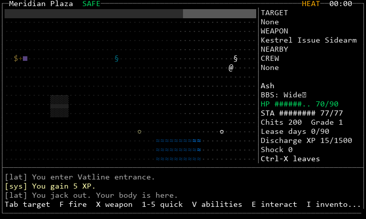
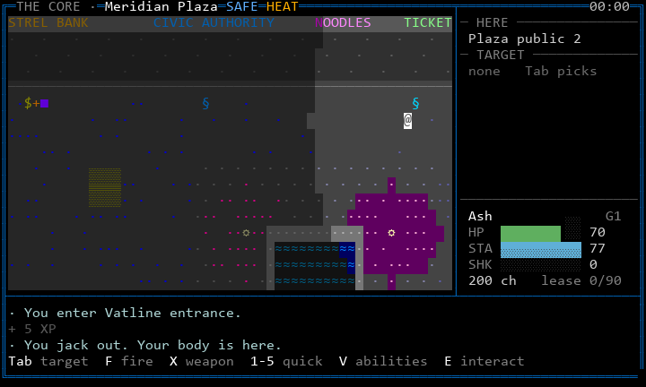

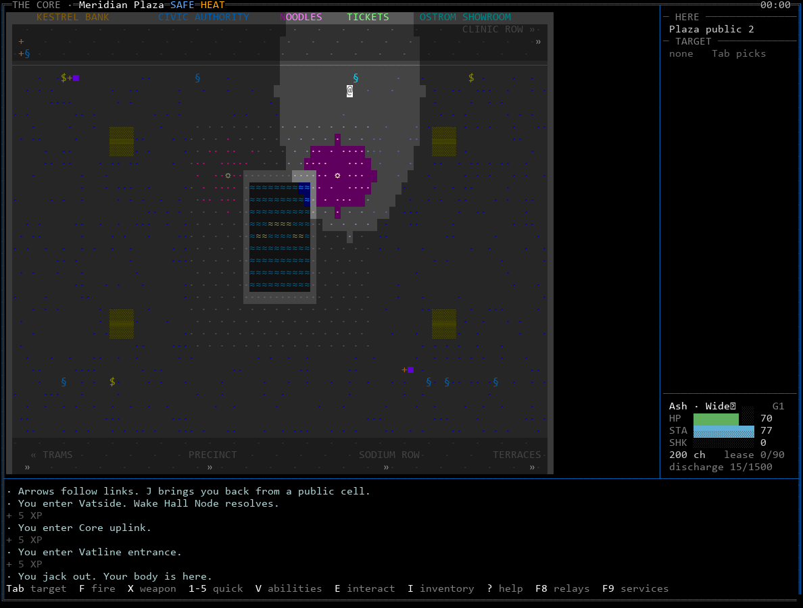

What to look for: the double blue frame and SAFE; the facade lettering
along the north side; the fountain and its glints; the lit wedge you can
see against the dimmed charted plaza; painted exit destinations along the
south; the place card reading the zone's own text.

### 9.2 Contested places: Clinic Row and the Wake Hall under heat

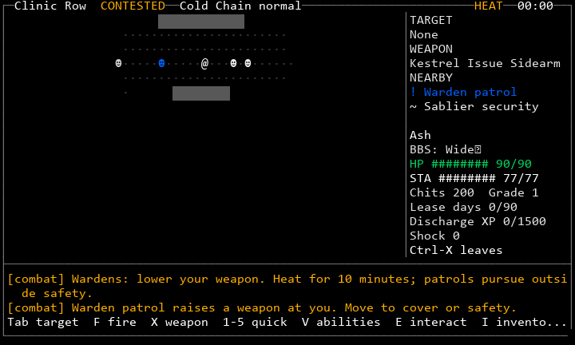
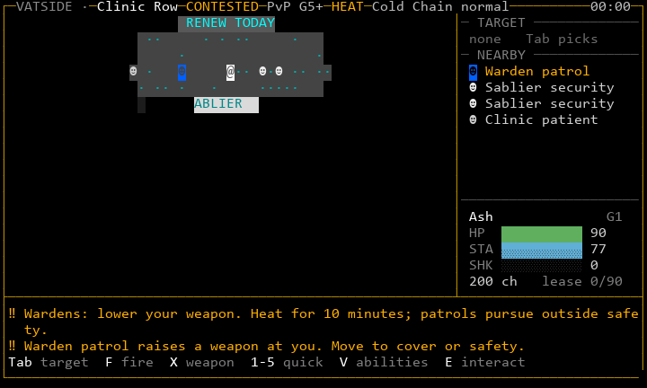
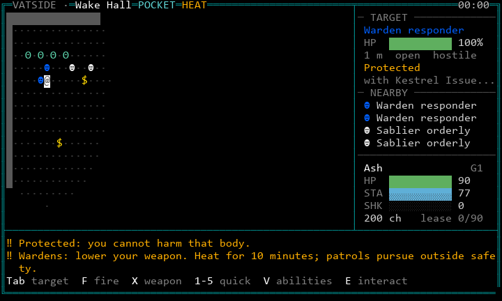

Clinic Row is not charted, so on arrival only what you can see is lit:
that is the honest look of a contested street you have not walked. The
Wake Hall frame was produced by firing on a Warden: the header carries
HEAT, the Warden is in TARGET with "Protected", and both danger lines
are amber with the `‼` gutter.

### 9.3 Sodium Row: shipped map and geometry candidate

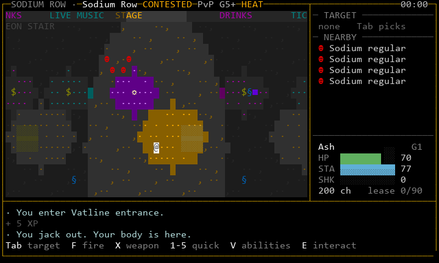
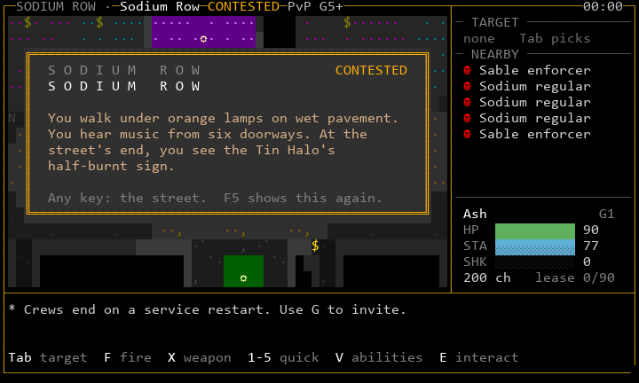
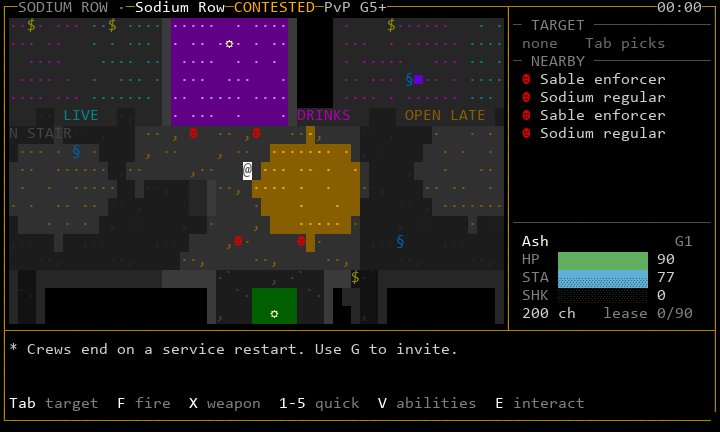
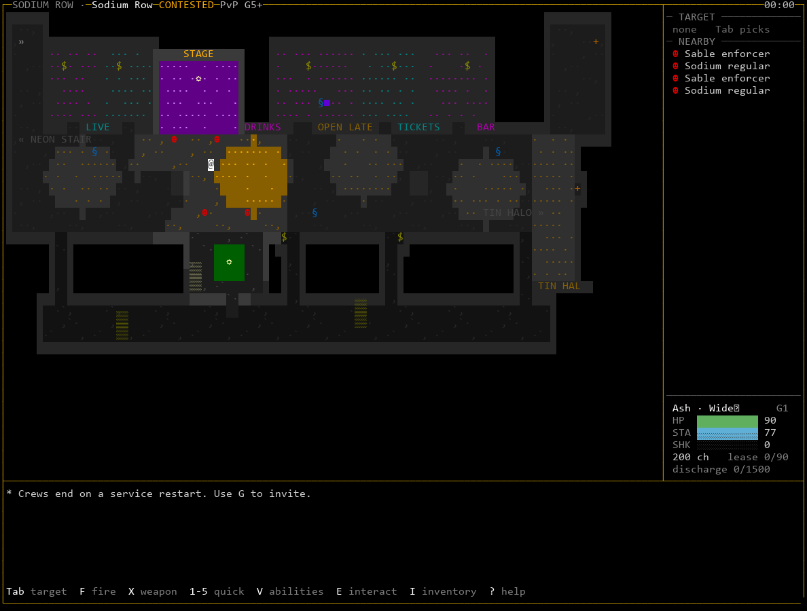
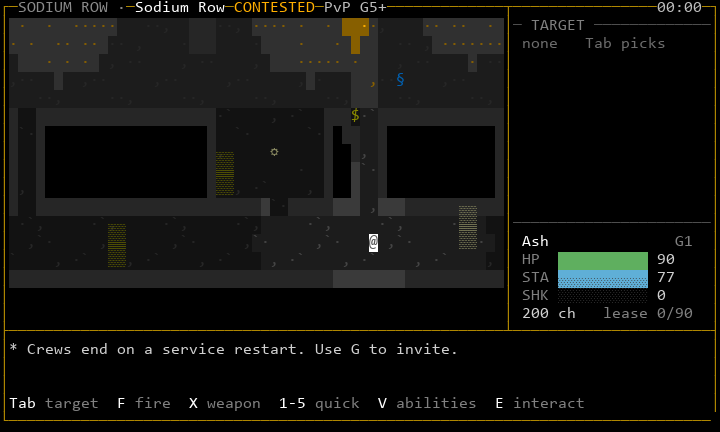

The shipped map is a 100x30 open rectangle; dressing can only light it.
The candidate (`candidates/sodium-row/`) gives it the gazetteer's
architecture: five bar alcoves and an open stage folded into the north
side, two kiosks that split the street into lanes, a card-table court,
alley mouths into a back alley where barrels give cover, and a small
square that ends at the Tin Halo's door, under its half-dead sign. It
moves objects and the Tin Halo door and changes sight lines, so it is
**S25 geometry under the human layout gate** (D9). It runs only as a
`content.local` overlay.

### 9.4 The Lattice: Vatside sector

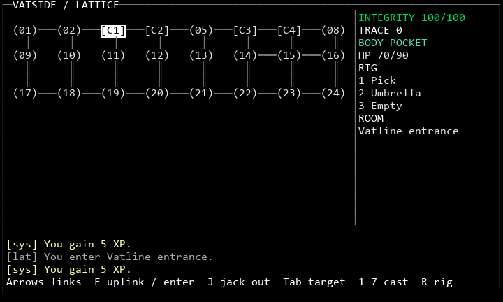
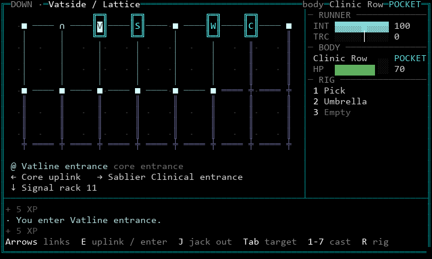
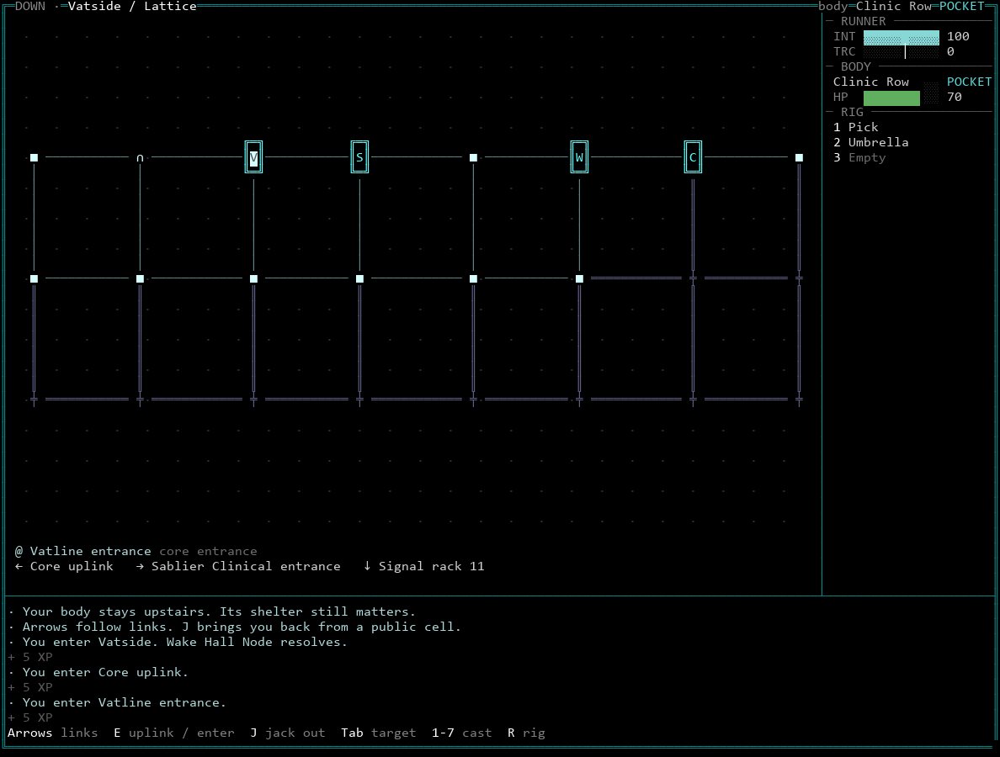

Linework on black; cores as lettered buildings; links named in words;
the frame is the body's (double teal: pocket). The sector content is
still a placeholder grid ("Signal rack 11"); a label pass is content work
(README section 9.1).

### 9.5 Tiers

Every scene also exists at 16 colours and truecolor
(`frames/*-80x24-16.png`, `*-80x24-truecolor.png`). The 16-colour frames
show the floor dot, grey known space and walls as `█` faces.

## 10. Creative latitude

Fixed by this contract: the principles (section 2), the shape
vocabulary (4.2-4.4, 4.8), the safety treatment (4.7), the ladder (4.1),
the panel order (5.2), the disclosure rules (8) and danger rules (7).

Left to the author of each place, within the validator and the
acceptance criteria: the theme colours, grain density and rhythm; where
light pools fall and how strong they are; what signs say (in canon
voice, no real or other-fiction names) and which are dead; which paint
marks exist; ambient lines (second person or impersonal, present tense,
concrete, short); which regions get their own theme. Two authors should
be able to dress the same street differently and both pass.

*Guidance for authors:* light where people gather, darkness where deals
go wrong. One loud colour per place, two at most; the rest quiet. Signs
name what the place is for. Leave some letters dead. Give every exit a
painted or signed destination.

## 11. Requirements for implementation agents

Automated (A) or human (H). Every A item has or needs a test.

**Rendering**

- R1 (A) Every play frame replays through `FakeTerminal` at 80x24 and
  132x50, three tiers, with a wide-character handle: no control bytes,
  no bottom-right write, no wide glyph split. *Built: `tests/door/test_present.py`.*
- R2 (A) The first row starts with `╔` on safe and pocket ground and `┌`
  on contested and open ground; the header contains the safety word.
- R3 (A) No map cell uses a letter except signs and paint from looks.
- R4 (A) No dressing glyph is in the rule set (tiles, things, people,
  Lattice shapes). *Built: validator.*
- R5 (A) In every ZoneView, `looks[y][x] == -1` exactly when
  `tiles[y][x] == -1`. *Built.*
- R6 (A) Removing every looks file changes no non-presentation view field
  on a scripted walk. *Built for the Plaza; extend to every dressed zone.*
- R7 (A) Rule grids (passable, opaque, cover, hazard, exit, object tiles)
  of shipped zones hash to committed fingerprints; a presentation change
  never moves a hash.
- R8 (A) For each theme and tier, the ladder bands differ by a minimum
  lightness step (to be fixed by the first contrast test; proposal:
  8 per cent in 256 and truecolor).
- R9 (A) 16-colour backgrounds are 0-7. *Built: validator.*
- R10 (A) Known space never shows people, objects' live state or warned
  tiles.
- R11 (A) Hostile entries (relation `!`) are drawn reverse video on the
  map and in NEARBY.
- R12 (A) Every view a caller can reach renders without the proposal
  fields (old servers) and without looks (undressed zones).

**Interaction**

- R13 (A) Any key on a place card closes it and is still processed.
  *Built.*
- R14 (A) A place card never renders while `threatened(body)`. *Built.*
- R15 (A) F5, F6 and F7 are never sent to the server and collide with no
  keymap binding (F8 relays and F9 services are taken).
- R16 (A) Ambient lines: at most one per 60 s per caller, none while the
  caller is in combat or travelling.
- R17 (A) Log: identical lines within 10 s coalesce; XP within 5 s
  merges; danger lines never merge with other kinds. *Built.*
- R18 (A) No danger line leaves the visible log within 10 s because of
  place, ambient or system lines.
- R19 (A) No operator notice reaches a new Wake's world log in its first
  five minutes.
- R20 (A, after D11) HERE names exactly the object E will use; a test
  presses E and compares.

**Content**

- R21 (A) Every hub zone has a looks file, a theme family and at least
  one sign naming its purpose, before S25 closes.
- R22 (A) Every exit in a dressed zone has a painted or signed
  destination within three tiles.
- R23 (A) Ambient lines follow the voice rules (bible 2): no em-dash,
  no banned words, at most 200 characters.
- R24 (A) Signs and marks contain no real or other-fiction names
  (checked against the glossary's banned list).
- R25 (A) Object `name`s shown in HERE are authored labels, not ids
  (today many are placeholders such as "Plaza public 2").

**Lattice**

- R26 (A) No `(nn)` cell labels; every link from the current cell is
  named in the caption.
- R27 (A) The Lattice frame's style follows `body_safety`.
- R28 (A) No background colour other than black in sector and core
  views, except the current cell.
- R29 (H, after content) Sector light follows the owner (Lattice 1).
- R30 (A, after field) The next trace threshold and its consequence are
  shown in words (Lattice 1, "the display always shows").

**Human acceptance** (a reviewer who has not read this document, through
a real NetBBS node, 80x24 and 132x50, 256 and 16 colours):

- R31 (H) Shown three frames with the header covered, the reviewer tells
  the Plaza, Sodium Row and the Lattice apart.
- R32 (H) Within five seconds the reviewer finds themself, names every
  interactable in view and says what is in reach.
- R33 (H) The reviewer names each person's class: caller, civilian,
  Warden, faction security, hostile, drone.
- R34 (H) The reviewer states the safety class from the frame alone.
- R35 (H) The reviewer says which part of the map is seen and which is
  only known, and expects people only in the seen part.
- R36 (H) The reviewer names the destination of every exit in view.
- R37 (H) Jacked in, the reviewer says where the body is, how safe it is,
  and where each link leads.
- R38 (H) The reviewer says something true about a place that the
  screen showed but did not state (who runs it, what it is for).
- R39 (H) With deutan and protan palettes, R31-R37 still pass.
- R40 (H) In a scripted fight and a hazard on each art mode (D8), no
  threat is noticed later than with the shipped renderer.

Passing tests and attractive captures do not satisfy R31-R40. They are
satisfied by people playing.

## 12. Decisions for the owner

### 12.1 Decisions

Each of these changes a game rule, what is disclosed, or an established
design decision. None is adopted by this document. "Trial" means it runs
in the playtest build behind a switch.

| ID | Decision | Why it needs you | State |
|---|---|---|---|
| D1 | Charted public geography: flagged safe and pocket hubs show their layout on arrival | changes what a caller knows; contradicts UI 2 "never-seen tiles are blank" | trial (`BLACKSITE_PRESENTATION_TRIAL`) |
| D2 | Known space is the place dimmed (grey in 16 colours, grey where 256 cannot keep the hue) | changes UI 2's "dimmed" rule | trial |
| D3 | The presentation content layer (themes, looks) and the additive view fields | new content format and protocol fields | built |
| D4 | Backgrounds as a first-class colour use; safety shown by frame line style; safe colour Warden blue instead of green | changes UI 1, 2 and 8 and existing palette roles | trial |
| D5 | Log kinds, place and ambient lines, coalescing, XP merge, operator notices out of the world log | changes UI 2 and 10 and the log's content | kinds and coalescing trial; ambient trial; notice move not built |
| D6 | Glyph changes: drones `τ`; jacked bodies reverse video instead of `▒`; `≡` for closed doors; `°` patrol waypoints (today `+`, the door shape); Lattice `∩ ∞ ╪`; letters reserved for signage | changes the glyph registry (UI 1) | trial |
| D7 | Lattice treatment: no fills, core buildings with initials, named links, body-safety frame, no `(nn)` | changes UI 3 | trial |
| D8 | Art prominence and layout tiers: place card on entry and F5 first; strip modes and a 132x50+ dashboard decided by playtest | changes UI 2 and 7 and assets 4 | card mode built; others not |
| D9 | Sodium Row geometry candidate | changes movement, sight, cover and object positions; S25 layout gate | overlay only |
| D10 | NPC colour by behaviour and what the caller can know, not faction: plainclothes and off-duty NPCs draw as civilians | changes what is disclosed (fixes two leaks) | not built; needs a server field |
| D11 | One server-side E resolver that both acts and previews, so HERE can name what E will do | engine change across about ten engines that each claim E | not built |
| D12 | Trial keys F5, F6, F7 and their permanent home (settings or keymap) | keymap is canon (UI 5) | trial |
| D13 | Fix the first-entry toast to show the zone's first paragraph, not its first wrapped line (today it cuts mid-sentence) | changes shipped text output | built for the proposal renderer only |

### 12.2 Canon edits on approval (top-down, same PR)

- `03-terminal-ui.md` 1: glyph registry additions and the
  16-colour background rule (D4, D6).
- `03-terminal-ui.md` 2: known and charted space (D1, D2); safety frame
  (D4); panel order; log kinds (D5); place card (D8).
- `03-terminal-ui.md` 3: the Lattice view (D7).
- `03-terminal-ui.md` 5: trial keys (D12).
- `04-assets.md` 3 and 9: the looks layer and its validator (D3); 4: the
  card as the vignette slot (D8).
- `01-entities.md`: `themes.json` and `looks/` formats (D3).
- `02-architecture.md` 5.4: looks and charted cells in the view (D1, D3).
- Gazetteer: a `charted` flag per hub (D1); Sodium Row's sketch if D9 is
  accepted.

## 13. How to play the trial

```
python scripts/playtest_68.py                       # shipped maps
python scripts/playtest_68.py --geometry candidate  # Sodium Row candidate
python scripts/playtest_68.py --colour 16           # another tier
```

The script starts a private service with the trial switches and runs the
door in the same console. A new Wake starts in the Wake Hall; Clinic Row,
Meridian Plaza and Sodium Row are a short walk (the Plaza's south side
leads to the Neon Stair). Jack in at a public terminal with J. F7 flips
between the shipped and proposal renderers on the same state, F5 shows
the place card, F6 changes when cards appear. The world persists between
runs; `--fresh` starts over.

What to judge, in this order: whether each place feels like somewhere
(R31, R38); whether danger is still the first thing you see (R40);
whether the card helps or gets in the way; whether the Sodium Row
candidate is worth taking to S25's layout review.

## 14. Known gaps

- Not yet played by a person. Every frame here comes from the harness;
  the trial needs the owner's session before any of it is judged.
- Only Meridian Plaza, Clinic Row and Sodium Row are dressed. The Wake
  Hall, Tin Halo, Vat Row, Tram Hub, Precinct and Terraces render with
  neutral defaults.
- No NetBBS transport check yet (Telnet CP437, SSH, web); that is S31.
- Sector owner light, trace consequence words, the City Map schematic,
  NPC behaviour roles (D10) and the E resolver (D11) are specified here
  and not built.
- Menus and text views still use the shipped renderer.
- The 256-colour lamp pools and the Plaza's lit wedge are first tuning
  values; expect to adjust them after play.
