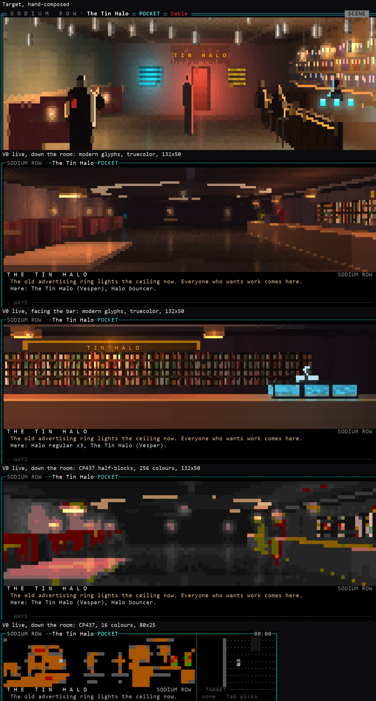

# V0: the Tin Halo, live

**Status: spike for the owner, issue #68, decision D-T10 (agreed
2026-10-25, cleared by the technical lead).** Not canon. Trial only:
everything here sits behind `BLACKSITE_PRESENTATION_TRIAL` and the
candidate geometry overlay, and the shipped game does not change. The
question it answers: can a renderer driven by authored look data reach
the visual target in section 10 of `paradigms.md`, and at what cost?



```
python scripts/playtest_68.py --geometry candidate --view scene --colour truecolor --glyphs modern
python scripts/presentation_mockups/v0_tin_halo.py   # captures, costs, the comparison sheet
```

In play, walk into the Tin Halo from the end of Sodium Row. `--glyphs
modern` needs a terminal font with the Unicode 13 sextants (Cascadia,
Iosevka, recent DejaVu); without it, leave it off and the same picture
draws in half-blocks.

## 1. What was built

- **Look data.** The Tin Halo's look gains a `scene`: the room's colours,
  its ceiling, how wet the floor is, haze, 18 lights and 38 pieces of
  dressing. The schema is in section 3 and becomes V3's draft.
- **Candidate geometry.** The shipped Tin Halo is an empty 44 x 22
  rectangle with vendors standing on open floor. Honest dressing needs
  tiles to stand on, so the overlay keeps the gazetteer's room (44 x 22,
  the street door in the north-west corner, tables, the bar across with
  Vesper at its end, the back room) and makes its furniture real: a
  counter of cover tiles with the vendors and the cabinet on it, four
  booths along the north wall, the Ferrymen liaison's table, and the
  boards and the back room door moved against the walls they hang on.
  It is a proposal for S25's layout gate, not a change to shipped maps.
- **The server** sends the scene only in the trial, and only the pieces
  and lights that stand on ground the caller knows, as it already does
  for looks.
- **The lit renderer** (`door/present/lit.py`). It casts rays over the
  view's tiles, as the street view does, and adds:
  - pieces as boxes, or as decals on walls;
  - per-pixel light from the authored lights, shaped by surface normals;
  - haze in depth, a glow around each light you can see, and its smear on
    the wet floor;
  - people as lit silhouettes.

  The static picture is painted once per position, heading and size and
  cached, so a frame only adds people. It draws scenes and auto's LOOK
  wherever a look has a scene, and the street view everywhere else.
- **Three outputs.**
  - Sextants: 2 x 3 pixels a cell, the modern glyph tier.
  - Half-blocks: 1 x 2.
  - 16 colours: half-blocks with backgrounds kept to colours 0-7.

  Each tier has its own colour mapping, built for lamplit rooms (section 5).
- **The glyph tier** is a door setting for now (`BLACKSITE_GLYPH_TIER`,
  `--glyphs`). Persisting it and the first-play check are V2's.

## 2. Honesty, and the tests that hold it

| Rule | How | Test (`tests/door/test_lit.py`) |
|---|---|---|
| Everyone drawn is an actor in the view | Figures come from `actors` only | Names in NEARBY, objects and unknown keys draw nobody; each of 12 random strangers changes only the columns where it stands |
| A faction mark is something the view already shows | The armband comes from the actor's `role` (`npc_sable`), the same colour the map uses | `test_a_faction_mark_comes_from_the_disclosed_role` |
| Dressing never stands where the map shows nothing | A piece between 0.2 and 1.7 high (where a body moves) may only stand on marked tiles: cover, a thing, a wall. Overhead pieces and floor marks may go anywhere | Validator: an obstacle on open floor is refused, overhead pieces are allowed |
| Dressing reveals nothing sight has not | Pieces and lights go out only over known ground; a partly known piece is clipped to its known tiles, and a ring, halo or sign goes out only whole | `test_scene_sends_only_dressing_on_known_ground` |
| Trial only | `looks.TRIAL` | `test_scene_is_trial_only` |
| Danger still takes the screen | Unchanged: threats hand over to TACTICAL | `test_a_threat_still_takes_the_screen` |
| Sextants only in the modern tier; every glyph one cell wide | Tier switch in the encoder | Six tier combinations; all 64 sextant patterns decode back to themselves at width 1 |
| Replays cleanly | No bottom-right write, no stray controls | Both views, both sizes, three tiers |

Nothing needed to play exists only in the picture: the people in it are
also in HERE and NEARBY, the things in reach are listed with `E`, and
the ways are the ways list. The picture adds atmosphere, never
information.

## 3. The look schema (draft for V3)

`looks/<zone>.json` gains an optional `scene` (`schema.py`: `LookScene`,
`SceneLight`, `ScenePiece`). Units are tiles; heights are above the
floor. A person stands 1.75 tall with eyes at 1.6.

| Field | Meaning |
|---|---|
| `interior` | A ceiling (true) or open sky |
| `ceiling` | Ceiling height (3.2 in the Tin Halo) |
| `walls`, `floor` | Base colours, `#rrggbb` |
| `wet` | How much the floor mirrors lights, 0 to 1 |
| `ambient` | Light everywhere, before any lamp |
| `haze`, `haze_reach` | The colour depth fades to, and how fast |
| `lights[]` | `at` [x, y], `z`, `colour`, `reach`, `power` |
| `pieces[]` | `kind`, `rect` [x, y, w, h], `z` [bottom, top], optional `colour`, `glow` (light it gives off), `text` and `role` (a sign's letters) |

Piece kinds: `counter`, `bench`, `table`, `shelf`, `screens`, `lamp`,
`cans`, `ring`, `sign`, `board`, `doorway`, `pipe`, `box`. A `shelf`,
`sign`, `board`, `doorway` or `screens` piece whose footprint lies on
wall tiles is drawn on the wall's face as a decal. The renderer gives each kind its
surface (tufted leather, bottles on planks, a brass edge, screens with
lines on them, a ring with dead segments), so authors place things and
do not paint them.

What the draft lacks: seated figures, light that moves or flickers,
shadows (light passes through pieces), diagonal facings, and authored
viewpoints (section 4).

## 4. Against the target

The comparison sheet at the top shows the target, two live shots in the
modern tier, and the room shot in both CP437 tiers. The live frames come
from the real door and server. The room shot faces down the room from
beside the bar, the target's framing. The bar shot faces the bar from
the middle of the room, as the zone text has it: "You see Vesper at the
end of the bar."

**What data already gets right.**
- Light as content: warm pools under the booth lamps and pendants, the
  dead ring overhead, cyan from Vesper's screens, the glow of the bottles.
- Dressing as content: booths, tables, the counter with its brass edge
  and foot rail, the back bar, the TIN HALO sign above it.
- People as lit silhouettes, rim-lit by the nearest lamp, with the
  bouncer's Sable armband.
- None of it was painted by hand.

**Where it falls short, and why.**

1. **Composition comes from geometry, not data.** The canonical room is
   44 tiles long, so seen from the door end the back wall is a sliver,
   and the back room and boards are lost in depth. The target was
   composed around a near back wall with the back room door at its
   centre. The gazetteer puts that door on the south side. The camera
   stands on your tile and faces only the four headings. Three ways to close
   the gap:
   - author a viewpoint per place: a public spot and a heading the
     establishing look uses, which is honest on charted ground;
   - allow diagonal headings;
   - accept that long rooms read as long rooms.
2. **Sight limits the people more than the room.** Charted dressing draws
   the whole room, but people appear only within sight 8. From the door,
   the far end of the bar is furnished and empty. Vesper appears only
   when you come within 8 tiles. This is correct, and it is a design
   question for pockets: should an interior's sight cover its room?
3. **People are small at a distance and hidden by furniture up close.**
   At the bar, Vesper shows shoulders up behind her own screens. The
   target placed its people where they read best. Live, they stand where
   the server put them. That is the honest choice, and a quieter picture
   than the target.
4. **Fine detail is authored, not emergent.** The target's cans, bottle
   labels and sharp silhouettes were drawn pixel by pixel. Live, a
   piece kind's surface rule makes bottles and leather, but cans in
   the halo read as speckle and silhouettes as blocks. More piece kinds
   and better surface rules close some of this. Some of it is
   the difference between a painting and a render.

**Tiers** (D-T9):
- **Modern tier, truecolor:** carries the mood.
- **CP437 half-blocks, 256 colours:** reads as a grey room with warm
  accents. The 256 palette has almost no dark warm colours, so lamplight
  either turns grey or turns red; V0 chooses grey with hue only where a
  hued colour is nearly as close.
- **16 colours at 80 x 25:** barely legible as a room. It shows that
  something is there, not what.

That supports the paradigm: build for the modern terminal, and let the
plain frame be plain. For 16 colours the owner may prefer the place
card or the map over a picture (decision V0-1 below).

## 5. Costs

Measured in the door process on the development machine, CPython 3.14,
by `v0_tin_halo.py`. *Picture* is the lit renderer alone; *frame* is the
whole door render including panel, log and the diff to bytes.

| Shot, tier, size | First picture | Cached picture | Cached frame | One step: picture | One step: bytes | Full frame: bytes |
|---|---|---|---|---|---|---|
| Room, modern, truecolor, 132x50 | 263 ms | 43 ms | 67 ms | 265 ms | 51.5 KB | 66.5 KB |
| Bar, modern, truecolor, 132x50 | 130 ms | 22 ms | 34 ms | 121 ms | 45.8 KB | 59.5 KB |
| Room, CP437, 256, 132x50 | 245 ms | 6 ms | 14 ms | 109 ms | 17.7 KB | 33.6 KB |
| Bar, CP437, 256, 132x50 | 163 ms | 9 ms | 21 ms | 120 ms | 16.5 KB | 33.1 KB |
| Room, CP437, 16, 80x25 | 18 ms | 2 ms | 7 ms | 16 ms | 2.2 KB | 6.8 KB |
| Bar, CP437, 16, 80x25 | 22 ms | 3 ms | 9 ms | 18 ms | 1.7 KB | 6.5 KB |

The full-screen look (auto's LOOK) in the modern tier: 274 to 574 ms
for its first frame, 111 to 122 KB. The numbers vary by about a factor
of two with machine load: under a parallel test run, a step took up to
0.6 s.

What this means:
- **Bytes.** A full modern frame is about 60 to 67 KB, and a step is
  46 to 52 KB, three times the 16 KiB per-delta ceiling. The full-screen
  look is about twice that. Half-blocks in
  256 colours are about 17 KB a step, at the ceiling. 16 colours are
  about 2 KB. Standing still costs almost nothing: only people who move
  are redrawn.
- **CPU.** A step repaints the static picture: 110 to 270 ms at
  132 x 50, and up to 0.6 s on a loaded machine. That is close to or
  slower than walking pace, and it is the door's CPU per caller. With
  the place cached, a frame is 20 to 70 ms; in 16 colours at 80 x 25
  everything is under 25 ms.
- **What would fix both.** Three options:
  - Hold the picture while you move and repaint it when you stop. The
    scene's words and ways update at once, and the picture catches up a
    moment later. This also keeps the bytes under the ceiling while
    walking.
  - Precompute light per tile, so a pixel costs a lookup instead of a
    loop over lights.
  - Draw half resolution while moving.

  The first is a design choice the owner can feel in play. The others
  are engineering for V1.

## 6. Decisions this raises

| # | Question | Where it belongs (technical lead's review) |
|---|---|---|
| V0-1 | In 16 colours, draw the lit picture, or show the place card or the map instead? | Client presentation |
| V0-2 | May a look author a viewpoint per place (a public spot and heading for the establishing look), so long rooms can be framed? | Presentation data; the validator checks the viewpoint is on public known ground |
| V0-3 | Should a pocket's sight cover the whole room, so people show where the dressing does? | A sight rule, not presentation |
| V0-4 | Should the picture repaint only when you stop (section 5)? | Client presentation |
| V0-5 | The candidate Tin Halo geometry (furniture as tiles) | The geometry rework, under S25's layout gate |

The technical lead's review (#73) adds V1 budgets to the plan (section
13.5): the picture within 100 ms p95 per step (a step is 200 ms), frames
coalesced so input is never delayed, looks in their own byte class with
a rate limit on full redraws, and dressing kept to the public-ground
region.

## 7. Not done

- Not played by a person yet; the captures are from the harness.
- Lights don't flicker, pieces cast no shadows, people never sit.
- The look (auto's LOOK, full viewport) uses the same renderer; it was
  captured but not tuned separately.
- Only the Tin Halo has a scene. Every other place keeps the street view.
- Chrome in the modern tier (eighth-block bars, diagonal arrows) is V2's.

**Invented for V0, not canon:** the place names and texts "Under the
halo", "The bar", "The booths", "The back room", "The quiet end", and
the Tin Halo's own place text; the three ambient lines; the inside
sign reading TIN HALO; the booths, pendants and colours. The halo of
cans over the door, the dead advertising ring lighting the ceiling,
Vesper with three screens at the end of the bar, the back room, the
boards, the bouncer and regulars, Red Sable and the Ferrymen liaison are
canon (gazetteer, dramatis personae).
