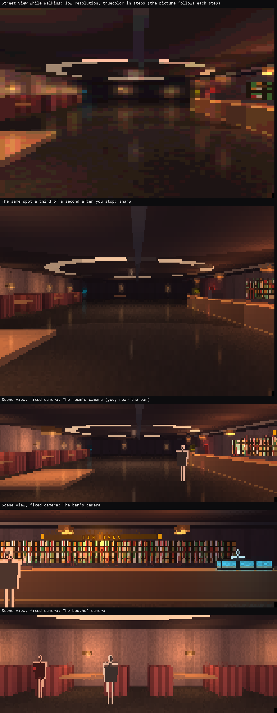

# V1: the lit picture within budget

**Status: early spike on the trial path, issue #68 (owner: "Go ahead with
V1", 2026-10-28; cleared by the technical lead as an early spike, plan
section 13.7).** Not canon, not for merging. Everything sits behind
`BLACKSITE_PRESENTATION_TRIAL` and the candidate geometry; the shipped
game does not change. V1's acceptance runs after the port onto P2's view
shapes and P5's client switch. This spike retires the performance risk
early: can the lit picture follow a walk inside the budgets of plan
section 13.5, with the owner's decisions V0-2 (a fixed camera per place)
and V0-4 (the picture follows the walk, sharp on stop)?



```
python scripts/playtest_68.py --geometry candidate --view scene --colour truecolor --glyphs modern
python scripts/playtest_68.py --geometry candidate --view street --colour truecolor --glyphs modern
python scripts/presentation_mockups/v1_budget.py [out] [--quick] [--frames]   # the measurements below
```

## 1. What was built

- **A fixed camera per place (V0-2).** A look's place may carry a
  `view`: a tile and a heading (`LookView` in `schema.py`, V3's draft
  schema). The validator refuses a viewpoint that is not public open
  ground (a wall, cover, a hidden exit). The server sends a place's
  viewpoint only when its tile is in the caller's known set; otherwise
  the door picks one itself, from tiles in the view it was sent: an open
  tile at the place's edge, facing in, that frames the most of it. The
  scene view's glimpse uses the camera of the place you are in and draws
  you as a figure. The candidate Tin Halo has a viewpoint for each of its
  six places.
- **Pictures kept by eye and known ground.** The door keeps what views
  of a zone have sent this caller, by zone position, and paints from
  that: nothing the server did not send, but a viewport that scrolls as
  you walk (at 80x24 it does) neither invalidates a kept picture nor cuts
  it off dark at its edge. The static picture
  (everything but people) is kept per eye, heading, size and grid, and
  per version of that known ground, so a picture prepared from here is
  still good when you get there. It is kept as
  bytes (8-bit pixels, float depth) with its cells already encoded; a
  frame copies the cells and re-encodes only those people stand in. The
  cache is an LRU bounded in bytes (24 MiB a caller).
- **Painting in slices (input never waits).** In the door the painter
  works on the door's own loop, a column at a time, about 4 ms per
  slice; keys and frames are handled between slices. While a picture is
  painted the last one stays up. Only the latest wanted picture is
  painted (coalescing). Pictures you are likely to want next are
  prepared while nothing is wanted: in the street view the turns and a
  step ahead; in the scene view the cameras of the other places whose
  viewpoints the server sent. A prepared picture gives way the moment a
  wanted one arrives, parked half-painted until there is time again.
  An earlier version painted on a thread; CPython's interpreter lock made
  keys wait for the painter (up to 180 ms measured), so the thread went.
- **A cheap class while you walk, sharp when you stop (V0-4).** While
  your eyes move, the street view paints at low resolution (half-blocks
  whose pixels are two cells wide: a sixth of the sextant pixels) and
  sends truecolor in 16 steps a channel, even to the eye. A third of a
  second after you stop, the sharp picture is painted and replaces it.
  256-colour callers keep their palette; 16-colour callers have no walk
  class (their pictures are cheap already). The fixed camera has none
  either: it does not move while you do.
- **Looks budgeted by rate (the technical lead's answer to 5.1).** While
  you walk, every frame draws on a budget that refills at 64 KiB a second
  (at most half a second's worth at once); when it is spent, the last
  picture stays up and the next goes out when it fits, so the picture
  rate drops to fit at large sizes, never the input. Whole new pictures
  that are not the walk (sharp on stop, a cut to another place's camera)
  go out at most once a second. On pictures above 3,000 cells (132x50)
  the walk uses one colour a cell pair instead of half-blocks: half the
  bytes, so it runs at about 2.5 to 3 pictures a second within the budget
  rather than 1.4. Ordinary views keep their 16 KiB.
- **Out of sight, a little dimmer.** V0 dimmed ground you remember but do
  not see now. The seen set changes with every step, which would make a
  kept picture useless, so V1 dims ground beyond your sight's reach from
  your eyes instead (read off the tiles the view marks as seen). Against
  V0 at the same spot, 97% of pixels are within 2 levels; the rest are
  spots inside your reach that something hides from you.

## 2. Disclosure

Unchanged from V0: figures only from the view's actors, dressing only on
known ground, scenes only in the trial. New for V1, each with a test in
`tests/door/test_lit_v1.py`:

- a viewpoint goes out only when its tile is known, and may not stand in
  a private instance;
- the door's own pick uses only tiles in the view it was sent;
- prepared pictures stand only on known, passable ground, and the cameras
  prepared for other places are only those the server sent;
- a kept picture is keyed by the known ground it was painted from, so it
  never stands in for a view that knows more or less.

## 3. Measurements

Reference host: the hosted Linux runner (4 CPUs, Python 3.12), workflow
`presentation-budget` on this branch; the full report is
[`target/v1/v1-budget.md`](target/v1/v1-budget.md). The route walks the
Tin Halo: 25 steps and turns with your eyes in the street view, 66 to 72
steps through all six places in the scene view, each stopping twice;
then the same route again on a warm cache. *Picture* is the lit
renderer's share of a door render. *Full* is a whole new screen: a cut
to another place's camera, danger handing the screen to the map, or a
whole view from the server.

**Picture time per step, p95 (cold: first visit / warm: again).**

| View | Tier | 132x50 | 80x24 |
|---|---|---|---|
| Street, walking | modern, truecolor | 30 / 2 ms | 9 / 1 ms |
| Street, walking | CP437, 256 | 67 / 1 ms | 19 / 1 ms |
| Street, walking | CP437, 16 | 49 / 8 ms | 14 / 2 ms |
| Street, the sharp picture on stop | modern, truecolor | 143 / 1 ms | 37 / 0 ms |
| Scene, a step in a place | all | 1 to 3 ms | 1 ms |
| Scene, a cut to another place | modern, truecolor | 67 / 4 ms | 17 / 1 ms |

In the door every cold paint runs in slices off the input path, so these
times delay the picture, never a key.

**Keys.** While four sharp pictures and their neighbours are painted, a
key waits at most 9.4 ms at 132x50 and 7.4 ms at 80x24. Painted on the
spot, V0's way, the same work holds keys for 147 ms and 41 ms.

**Walking in real time** (a step every 200 ms, on the walk's budget of
64 KiB a second). *Lag* runs from a step until a picture of it, or of a
later step, is up.

| Case | Pictures a second | Bytes a second | Lag p95 / max | Steps shown within the step |
|---|---|---|---|---|
| modern, truecolor, 132x50 | 2.8 | 72.8 KiB | 388 / 448 ms | 14 of 25 |
| CP437, 256, 132x50 | 4.8 | 57.3 KiB | 14 / 56 ms | 25 of 25 |
| modern, truecolor, 80x24 | 4.8 | 58.6 KiB | 18 / 28 ms | 25 of 25 |
| CP437, 256, 80x24 | 4.8 | 34.9 KiB | 5 / 18 ms | 25 of 25 |

At 132x50 in truecolor the budget holds the picture rate to about 2.8 a
second, as designed: the picture is never more than half a second behind
you. The walk of 5 seconds runs a little over 64 KiB a second because the
budget may spend half a second's worth at once; sustained, it settles at
64. Elsewhere the picture keeps up with every step.

**Bytes per frame, p95** (max where it matters):

| View | Tier | 132x50 | 80x24 |
|---|---|---|---|
| Street, a walking picture | modern, truecolor | 31.9 KiB | 14.9 KiB |
| Street, a walking picture | CP437, 256 | 17.5 KiB | 9.8 KiB |
| Street, a walking picture | CP437, 16 | 15.3 KiB | 4.7 KiB |
| Street, sharp on stop (at most once a second) | modern, truecolor | 105.3 KiB | 27.3 KiB |
| Scene, a step in a place | modern, truecolor | 7.8 KiB | 2.4 KiB |
| Scene, a step in a place | CP437, 256 / 16 | 3.8 / 2.0 KiB | 1.5 / 0.9 KiB |
| Scene, a whole new screen (at most once a second) | modern, truecolor | 57.8 KiB | 19.4 KiB |
| Standing still | all | 0 | 0 |

Whole new pictures stay under the 128 KiB class; a scene step's maximum
(up to 51 KiB) is a cut the once-a-second rule held back and sent with
the next step.

**Memory.** The cache peaked at 2.6 MiB a caller on these routes (cap
24 MiB, LRU).

Local numbers on the development machine (Windows, Python 3.14, about
half its CPU taken by other work) run two to four times slower and much
noisier; the shape is the same. An early thread-based painter measured
there let keys wait up to 180 ms, which is why painting moved onto the
door's loop in slices.

## 4. Against the budgets (plan 13.5)

| Budget (13.5) | V1 |
|---|---|
| A step's picture within 100 ms p95 on the reference host | **Met** in every tier and size, cold (worst: 67 ms, street view, 256 colours, 132x50). Warm, 1 to 8 ms. |
| Frames coalesce; a slow paint never delays input | **Met.** Painting runs in slices between keys (keys wait at most 9.4 ms); only the latest wanted picture is painted; prepared pictures give way. |
| Looks have their own byte class, with a rate limit on full redraws | **Met, provisionally** (the classes the technical lead set, to be confirmed over real transports): the walk within 64 KiB a second at any size, whole new pictures at most 128 KiB and once a second, ordinary views 16 KiB. |
| Measured over the real NetBBS SSH and web paths | Not part of the spike (V1 acceptance). |
| Dressing limited to the declared public-ground region | Unchanged from V0: dressing goes out only over known ground. The region itself is D1's precondition (P4/P6). |

## 5. Settled with the technical lead (review of #80)

1. **Byte class: by rate.** 64 KiB a second sustained while walking, at
   any size, the picture rate dropping to fit; whole new pictures up to
   128 KiB at most once a second; ordinary views 16 KiB. Provisional
   until measured over real transports at V1 acceptance. Built here
   (section 1); the picture rate at 132x50 was the presentation lead's
   call: one colour a cell pair for the walk, about 2.5 to 3 a second.
2. **A whole view redraws the whole screen** (`model.py`, `force_full`;
   about 19 KiB at 80x24 whenever the viewport scrolls, in every view):
   P5, recorded in P1's baseline. If it hurts the shipped map before
   then, a small client-only slice with identical goldens.
3. **Colour codes** (`Style.sgr` re-sends both colours after a reset):
   P5.
4. **V0-3** (in lit pockets, sight covers the room): not in this spike.
   Its text goes into P0 (#75); its code into whichever slice first ships
   lit looks for real (P6 or V3), the fingerprint moving for lit pockets
   only.
5. **The viewpoint check** becomes "inside the public-ground region" once
   D1 is decided. Until then the validator also refuses a viewpoint in a
   private instance; rooms behind an owner's door wait for the region,
   which zone data cannot express yet.

For the port (advisories): the painter becomes display state instead of
a module global (`lit.PAINTER`); the door's known ground is keyed by
instance if instanced zones ever share ids; the budget workflow stays
off `main`'s triggers.

## 6. Not done

- The port onto P2's view shapes and P5's client switch, and V1's
  acceptance there.
- Measuring over the real NetBBS SSH and web transports (V1 acceptance).
- The walk's picture in auto's LOOK: auto keeps the street view's
  behaviour.
- Not played by a person yet; the frames and numbers come from the
  harness.
